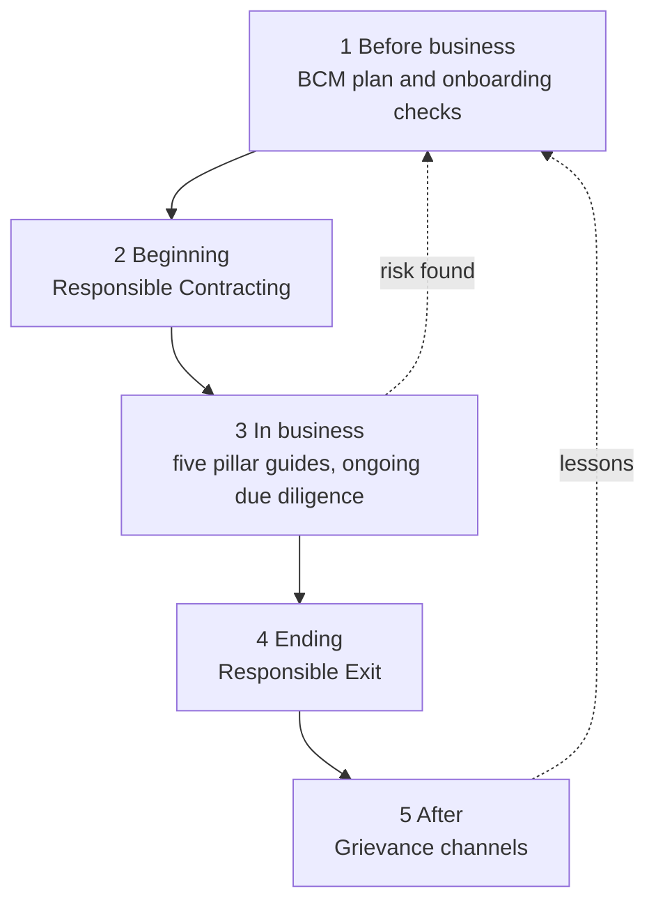

# Practical Guide to Supply Chain Due Diligence

## Panorama Map

**Six-Pillar Architecture | Business Continuity Integration | Quality Management Positioning**

This document serves as the navigation framework for the complete set of Due Diligence (DD) practical guides, answering three key questions:

1. What areas does supply chain due diligence cover, and how do they collaborate?
2. What is the relationship between Business Continuity Management (BCM) and due diligence?
3. Why is quality management not an independent due diligence pillar, yet closely related to all of them?

*Note: This chapter can be used independently for project kick-off meetings, management reports, or new member onboarding.*

---

## 0.1 Why Supply Chain Due Diligence Needs Six Pillars

Traditional supply chain management focuses on price, delivery, and quality. However, modern Responsible Business Conduct (RBC) requires companies to manage the negative impacts on Social, Environmental, and Governance (ESG) factors. While the OECD provides a broad framework, practice has evolved into six specialized, interrelated fields.

| Pillar | Core Question | Main Framework |
| :--- | :--- | :--- |
| **1. Social Responsibility** | How does the supplier treat workers and the community? | ILO Conventions, SA8000, LkSG (Germany) |
| **2. Environmental Compliance** | How does the supplier manage environmental impact? | ISO 14001, GHG Protocol, EU CSRD |
| **3. Supply Chain Security** | Can the supplier guarantee goods and data integrity? | C-TPAT, AEO, ISO 27001, GDPR |
| **4. IP & Anti-Counterfeiting** | Does the supplier infringe IP or use fake materials? | TRIPS, US NDAA, SAE AS5553 |
| **5. Ethics & Finance** | Is the business conduct honest and financially healthy? | ISO 37001, FCPA, D&B Credit Ratings |
| **6. Mineral Traceability** | Does the raw material source meet responsible standards? | OECD 5-Step, RMAP, UFLPA |

---

## 0.2 How the Six Pillars Interrelate

These pillars are not silos. A failure in one often signals a risk in another.

* **Social ↔ Environmental:** Unregulated mining often involves both child labor and toxic pollution.
* **Social ↔ Ethics:** Corruption (bribes) is often used to hide labor violations.
* **Security ↔ IP:** Cargo tampering is the primary entry point for counterfeit goods.
* **Finance ↔ BCM:** Financial instability is the leading indicator of a future supply disruption.

---

## 0.3 Business Continuity Management (BCM) vs. Due Diligence

Due diligence identifies **current** risks; BCM plans for **future** interruptions.

| Dimension | Supply Chain Due Diligence | BCM |
| :--- | :--- | :--- |
| **Core Question** | Is the supply chain compliant/responsible? | Can we operate if the supply chain breaks? |
| **Perspective** | Current status assessment | Future scenario planning |
| **Standard** | OECD DDG, UNGPs | ISO 22301 |

### BCM Trigger Decision Tree
Use DD findings to trigger BCM actions:
* **Sole Source:** If no substitute exists, immediately set safety stocks and find a backup.
* **Disaster Zone:** If a supplier is in a high-risk climate zone, request their BCM plan.
* **Financial Stress:** If a supplier's credit drops, pre-qualify an alternative vendor.

---

## 0.4 Comprehensive Supplier Risk Scoring Matrix

We use a 100-point weighted system to classify suppliers and determine audit frequency.

| Pillar | Weight | Data Source |
| :--- | :--- | :--- |
| Labor & Social | 20% | Audit reports (SMETA/SA8000) |
| Environmental | 15% | ISO 14001, Carbon data |
| Security & Data | 20% | C-TPAT status, ISO 27001 |
| IP Protection | 10% | Counterfeit history, customs records |
| Ethics & Finance | 20% | Credit ratings, Anti-bribery policy |
| Traceability | 15% | CMRT quality, Smelter compliance |

### Action Matrix
* **85–100 (Low):** Audit every 2 years. Preferred status.
* **70–84 (Med):** Annual audit. Focus on specific improvements.
* **55–69 (High):** Audit every 6 months. Mandatory Corrective Action Plan (CAP).
* **< 40 (Fail):** Immediate suspension of orders and start of replacement process.

---

## 0.5 Quality Management's Position

Quality (ISO 9001) is a **foundational indicator**, not a standalone DD pillar.

* **Why?** Quality is about product specs (performance); DD is about operational ethics (compliance).
* **Integration:** A strong Quality Management System (QMS) acts as a "proxy" for management maturity. If a supplier fails quality basics, they will almost certainly fail complex DD pillars like Ethics or Traceability.

---

## 0.6 Scope of Application: Who gets audited?

| Supplier Type | Social | Env | Security | IP | Ethics | Minerals |
| :--- | :---: | :---: | :---: | :---: | :---: | :---: |
| **Manufacturers** | Full | Full | Full | As needed | Basic | If applicable |
| **Traders** | Basic | Basic | Key | Full | Full | Transparency |
| **Software/IT** | Basic | Light | Full | Full | Basic | N/A |
| **Logistics** | Basic | Carbon | Full | N/A | Basic | N/A |

*(Full = Comprehensive Audit | Basic = Questionnaire | N/A = Not Applicable)*

---

## 0.7 Series Usage Guide

This guide is part of a larger toolkit. For deep dives, refer to the following specific manuals:
1.  **Social Audit Guide:** Detailed labor standards and ILO compliance.
2.  **Environmental Guide:** ISO 14001 and carbon footprinting.
3.  **Security & Data Guide:** Physical C-TPAT and digital GDPR/ISO 27001.
4.  **IP & Ethics Guides:** Anti-counterfeiting and anti-corruption protocols.
5.  **Mineral Traceability Guide:** OECD 5-step methodology.

---

## 0.8 Where each guide fits: the life of a business relationship

The six pillars describe *what* due diligence looks at. The life of a business relationship describes *when*. Every buyer–supplier relationship passes through the same five stages, and each guide in this series serves one of them. A responsible exit begins with a responsible entry: the contract signed at the start decides how the end can be handled.

| Stage | Question | Guide | Size |
|---|---|---|---|
| **1 Before business** | Should we work with this supplier, and can we survive if it fails? | [Due Diligence Handbook](/en/dd-guide) (risk assessment, onboarding); section 0.3–0.4 above (BCM triggers, risk scoring); [Country Reference](/en/country-ref). A full value-chain BCM guide is in preparation. | Full guide |
| **2 Beginning** | What do we promise each other, and what happens if things change? | [Responsible Contracting](/en/contract-guide): two-way clauses, payment and order terms, a contract checklist | Short guide + checklist |
| **3 In business** | Is the supplier meeting the standards, and are we buying responsibly? | [CSR](/en/csr-guide), [Environmental](/en/env-guide), [Security](/en/security-guide), [IP](/en/ip-guide), [Ethics & Financial Resilience](/en/ethics-guide); continuous audits in the [Due Diligence Handbook](/en/dd-guide) | Full guides |
| **4 Ending** | How do we end the relationship, close or relocate without leaving the workers to pay? | [Responsible Exit](/en/exit-guide), with a [role-based checklist](/en/exit-checklist) and [sample policies](/en/exit-policies) | Full guide + tools |
| **5 After** | Can people still raise problems, and does anyone answer? | [Grievance Channels](/en/grievance-guide): how a channel should work, a policy outline, and a checklist to verify a partner's channel | Short guide + checklist |

The arrows back to stage 1 matter. A risk found during the relationship, or a grievance after it, should change how the next supplier is chosen and the next contract is written.
