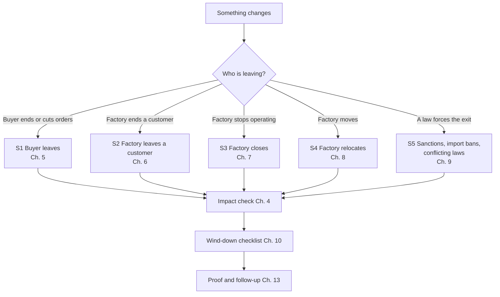
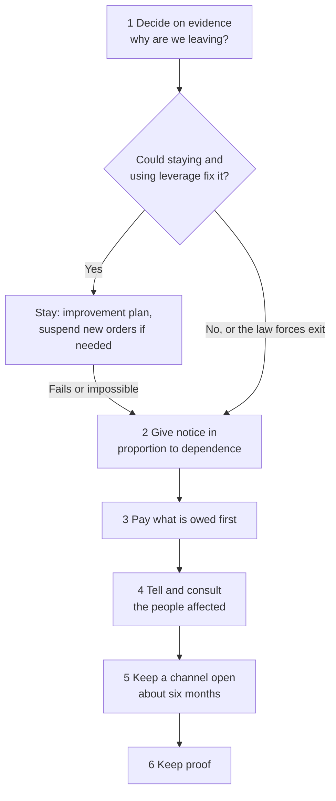
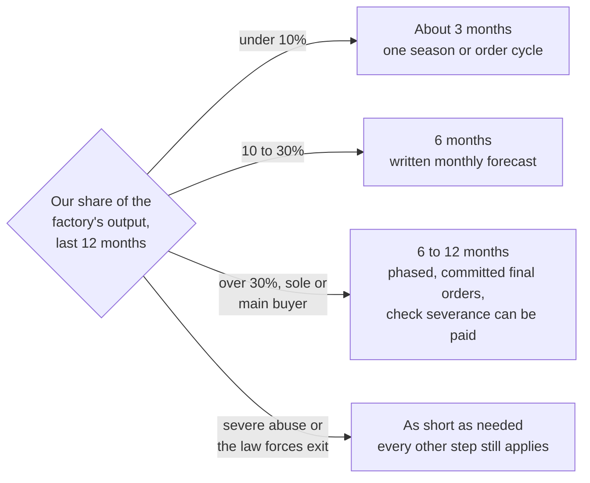

# Responsible Exit Guide

**Ending a business relationship, closing or relocating a factory, without leaving the workers to pay**

*Edition 1, November 2026. For buyers (brands, importers, trading companies) and factories (owners, HR, finance), especially small and medium-sized manufacturers in China.*

::: tip How to use this guide
- **Short of time?** Read the key messages and the map below, then go to your situation (chapters 5–9).
- **Buyer about to reduce or end orders?** Chapters 4, 5 and 10.
- **Factory losing or dropping a customer?** Chapters 4, 6 and 10.
- **Factory closing or moving?** Chapters 7, 8, 11 and the closure checklist in 14.5.
- **Forced to stop by sanctions or an import ban?** Chapter 9.
- **Auditor or verifier?** Chapters 11 and 13.
- **Want only your steps?** The [role-based checklist](./exit-checklist) picks them out for you. [Sample exit policies](./exit-policies) for buyers, factories and agents are ready to adapt.
:::

---

## Key messages

1. **Every exit has a cost. The question is who pays it.** When a buyer leaves without notice or a factory closes without severance, the cost lands on the workers, who had no say in the decision.
2. **Exit is sometimes right.** Responsible exit is about *how* to leave, not a rule that you must stay.
3. **Notice should match dependence.** The bigger your share of the other side's business, the longer the notice and the more careful the ramp-down. Six months is the reference for a significant buyer.
4. **Pay what is owed first.** Goods made, materials bought, wages, severance, social insurance. Most exit disputes are about money that was already owed.
5. **In China, the law already sets the sequence** for a closure: consult, pay, transfer, liquidate, deregister. Skipping steps is how a closure becomes a crime.
6. **Factories exit too.** A factory that drops a customer, closes or moves abroad has the same duties towards its workers as a buyer that leaves it.
7. **Relocation abroad is a closure** in Chinese labour law. The workers left behind are owed severance.
8. **Sanctions and import bans can force a fast exit.** They limit *whether* you can stay, not *how carefully* you leave.
9. **Keep proof.** Written notice, payment records and a grievance channel for six months after the exit.
10. **Plan the exit before you need it.** A severance reserve, clean social insurance records and exit clauses in contracts cost little in good times.

### The five situations at a glance

| | What happens | Buyer's role | Factory's role |
|---|---|---|---|
| **S1 Buyer leaves** | Buyer ends, suspends or sharply cuts orders | Plans and carries out the exit | Protects workers, recovers money, refills capacity |
| **S2 Factory leaves a customer** | Non-payment, losses, end-use concerns, capacity | Secures continuity, tooling, transition | Plans and carries out the exit |
| **S3 Factory closes** | Closure, dissolution, bankruptcy | Detects early; checks workers are paid | Follows the closure sequence in law |
| **S4 Factory relocates** | Same city, another province, abroad | Re-qualifies the site; checks the old site is settled | Settles the old site; doesn't repeat the pattern |
| **S5 Forced exit** | Sanctions, forced-labour import bans, counter-measures | Uses whatever room the law leaves to mitigate | Protects workers when buyers must stop suddenly |

---

## 1. What "responsible exit" means

### 1.1 The name

**Responsible exit** (负责任退出) is the plainest and most widely used term. ACT, Fair Wear, the Clean Clothes Campaign, IndustriALL and brands such as C&A, Primark, M&S and Inditex use it, as do development banks. Other documents say the same thing in other words:

| Term | Used by | Meaning here |
|---|---|---|
| Responsible disengagement | OECD, ETI (2026) | The same, including sharp cuts in orders, not just ending |
| Suspension or termination of the business relationship | EU CSDDD, Germany's LkSG | The legal wording |
| Responsible retrenchment and closure | FLA, ILO and IFC Better Work | The factory-side wording, focused on the workforce |
| 有序退出、妥善安置职工 | Chinese government policy since 2016 | Orderly exit with proper resettlement of workers |
| Cut and run (一走了之) | Critics | What this guide is about avoiding |

**Which name is most common?** We counted the terms in 56 public documents: brand policies, industry initiatives, international norms, laws, development-finance standards, and NGO and union reports. "Responsible exit" is the phrase brands, initiatives and NGOs use most. Norms and laws prefer "disengagement", "suspension" and "termination"; no law in the sample says "responsible exit". Development banks speak of "retrenchment", meaning layoffs. "Factory closure" is mostly an NGO and union term.

<ClientOnly><ExitHeatmap lang="en" :rows="termValues('en').rows" :cols="TERMS.cols.en" :values="termValues('en').values" note="Share of documents in each group that use the term at least once (n = number of documents). Hand-picked sample, November 2026; ten documents use none of these terms. The UN Guiding Principles say 'ending the relationship'." /></ClientOnly>

We use **responsible exit** throughout because it is the term the people who act on it, buyers and factories, already use. It covers all five situations: a buyer leaving, a factory leaving a customer, a closure, a relocation and a forced exit. Readers searching for "responsible disengagement" or "suspension" will find the same thing here.

### 1.2 What "responsible" means, in six points

1. **Decide on evidence.** Know why you are leaving and whether staying would do more good.
2. **Give notice in proportion to dependence.** A buyer taking 40% of a factory's output owes more notice than one taking 2%.
3. **Pay what is owed first.** Before new claims, discounts or penalties.
4. **Tell and consult the people affected.** Workers and their representatives, not only management.
5. **Keep a channel open afterwards.** Problems surface after the last order.
6. **Keep proof.** For your own protection as much as for anyone else's.

---

## 2. Why exits go wrong: what the evidence shows

### 2.1 When buyers leave

- **COVID-19, Bangladesh, March 2020.** A survey of 316 suppliers found that when orders were cancelled, 72.1% of buyers refused to pay for raw materials already bought and 91.3% refused to pay production costs. 97.3% gave no help with severance. The authors noted this happened despite many brands having "responsible exit" policies. Worldwide, about USD 40 billion in orders was cancelled or not paid in the first weeks; at least USD 15 billion was later paid after public campaigns. *(Penn State CGWR and WRC, Abandoned?, March 2020; Unpaid Billions, October 2020.)*

  **How big was it?** By the end of April 2020, Bangladeshi exporters reported USD 3.18 billion of orders cancelled or put on hold, at 1,150 factories employing 2.28 million workers: **about a tenth of a whole year's garment exports**, and far more than a tenth of the orders due that spring. April's exports fell 85% on the year before. *(BGMEA tracker as reported in April 2020; Export Promotion Bureau. Some held orders were later reinstated.)*

  <ClientOnly><GlanceBars :items="D.bdScale.en" unit=" bn USD" :digits="2" /></ClientOnly>

  What suppliers said buyers did (share of buyers, except the first bar):

  <ClientOnly><GlanceBars :items="D.bdSurvey.en" unit="%" :digits="1" :max="100" /></ClientOnly>
- **The "cut and run" example.** In 2013, after the Tazreen fire, Disney told licensees to stop production in Bangladesh and four other countries. Critics pointed out that leaving did nothing for the workers who stayed in those factories.
- **Sole buyers and social insurance.** When KOA Modas in Guatemala closed in February 2025, its only buyer was Target. About USD 6 million in severance and back wages was paid after the Worker Rights Consortium intervened. Another USD 6 million in social-security deductions, apparently withheld for years, had never been deposited. *(Advocacy report, August 2026.)* Being the only buyer raises your share of responsibility, and wages are not the only thing to check.
- **The subcontractor defence.** When Violet Apparel in Cambodia closed in 2020 owing 1,280 workers about USD 1.4 million, the brand said the factory had not been authorised to make its goods. The workers had no other route to payment. *(Human Rights Watch, July 2023.)*
- **No electronics brand publishes an exit policy.** SOMO and China Labour Bulletin found in November 2024 that 8 of 20 major brands sourcing from China disclosed an exit policy, all of them apparel. None of the electronics brands did.

  **Exit policies are spreading, slowly, and in one industry.** The chart counts companies and initiatives for which we found public evidence of a responsible exit policy or procedure, by the earliest year found. It is not a census: most policies carry no date, and more exist. All are apparel, footwear or retail. Electronics, toys, furniture and general manufacturing have none on record.

  <ClientOnly><ExitChart mode="line" lang="en" :data="series(D.policies, 'en')" label="Companies with public evidence of an exit policy, cumulative" note="Cumulative count, earliest public evidence found. Sources: Fair Wear, adidas, Nike, Kmart, ACT, JD Sports, Primark, Lidl, Inditex, VF, C&A; SOMO (2024)." /></ClientOnly>

### 2.2 When factories close or move

- **Social insurance on base wage.** At Yue Yuen in Dongguan (2014), tens of thousands of workers struck over social insurance and housing fund paid on base wage rather than full wage, fearing the gap would be lost if the plant moved. At Stella International (2015), the dispute was over housing fund arrears.
- **Moving orders abroad without severance.** In 2024 a Dongguan furniture maker moved production to Southeast Asia, leaving a 54-year-old worker owed more than RMB 80,000 in redundancy pay. A Shenzhen factory announced a six-month production halt instead of layoffs; workers said its orders had gone to Vietnam. A halt paying only a living allowance avoids statutory severance, and workers protested. *(BBC via BHRRC; press reports, April 2024.)*
- **Owners who disappear.** Courts regularly convict owners who abscond owing wages. In a Shandong case published in April 2026, a textile company's operator who owed RMB 389,700 and absconded was sentenced to six months and fined; the company was fined too. Nationally, prosecutors approved 612 arrests and prosecuted 1,495 cases for refusing to pay wages in 2024, recovering more than RMB 244 million. *(Shandong typical cases, April 2026; Supreme People's Procuratorate, January 2025.)*
- **The scale.** In the 2025 winter campaign against wage arrears, authorities handled 280,000 cases and recovered RMB 14.83 billion for 1.48 million workers. No breakdown by closure is published.
- **Is it rising?** Worker protests are one of the few long series. China Labour Bulletin's Strike Map recorded collective actions each year until it closed in 2025; most were about unpaid wages, and in 2023 a wave of electronics factories closing or relocating doubled the count. The map caught only an estimated 5–10% of incidents, so read the shape, not the level.

  <ClientOnly><ExitChart lang="en" :data="series(D.clb, 'en')" label="Collective actions recorded by China Labour Bulletin per year" note="Incidents per year, China Labour Bulletin Strike Map (archived). 2016 has no verified total; 2025 covers January to early May." /></ClientOnly>

- **"Cut and run" still happens, but it is punished more.** Prosecutions for refusing to pay wages (Criminal Law Art. 276-1) have risen since 2022. The figures mix full-year and January–November periods; partial years are hatched.

  <ClientOnly><ExitChart lang="en" :data="series(D.spp, 'en')" label="Persons prosecuted for refusing to pay wages, China" note="Persons prosecuted, Supreme People's Procuratorate. 2023 is back-calculated from the 2024 growth rate." /></ClientOnly>

- **Wage funds don't cover severance.** Shenzhen's wage guarantee fund advanced RMB 72.42 million to 3,965 workers in 2025 and recovered only RMB 4.02 million from employers. It covers wages, not severance.

### 2.3 When it goes right

- **Samsung, Huizhou, 2019.** Samsung closed its last phone plant in China in stages. It stopped hiring in March, opened voluntary departures with compensation in June, held on-site job fairs with other employers from July, and stopped production at the end of September. Workers received wages owed, severance and the final housing fund payment.
- **Sony, Huizhou, 2024.** Sony sold its precision-parts plant to a new owner. Press reports say it offered staff compensation well above the legal minimum ("N+3"). *(Single secondary source; treat the figure as reported.)*
- **Myanmar, 2022–2024.** Primark, M&S, H&M and Inditex left Myanmar in stages under a framework agreed with the global union IndustriALL: no new orders, existing orders completed, worker representatives consulted, full severance, and evidence of payment requested. No independent audit of severance actually paid has been published.
- **Industrial Hana, Guatemala, 2023–2025.** When the factory closed owing USD 1.5 million in severance, three former buyers each paid USD 500,000. It took two years and a campaign.
- **Jerzees, Honduras, 2009–2010.** A factory closed after workers unionised. The remedy was not only money: the company opened a new plant, rehired former workers and recognised the union.
- **China's own model.** When China cut steel and coal overcapacity in 2016, the central government set up a RMB 100 billion fund paid partly by the number of workers to be resettled, with "worker resettlement as the priority". Planned closure with ring-fenced money for workers is a domestic idea, not a foreign one.

### 2.4 What the cases teach

| Lesson | Cases |
|---|---|
| Some brands pay after a closure, but late and only after pressure | PT Kizone, Brilliant Alliance, Vald'or, Industrial Hana (below) |
| Other brands never pay, even under years of pressure | Jaba Garmindo, Hulu Garment, Violet Apparel, Body Fashion (below) |
| Check social insurance, not just wages | Yue Yuen, KOA Modas, Vald'or (pension and health contributions stolen) |
| Sole and main buyers carry more responsibility | KOA Modas |
| Subcontractors fall through the gaps | Violet Apparel, Industrial Hana |
| Halting production can be a way to avoid severance | Shenzhen 2024 |
| Planned, staged closures work | Samsung Huizhou, Myanmar framework |
| Remedy can mean jobs, not only money | Jerzees |

**Who paid, and when.** In every case below where a brand paid, the money came **10 months to more than 2 years after the closure**, and only after a campaign or an investigation. Payments were often framed as a loan, a "humanitarian contribution" or a confidential settlement, not as an admission of liability.

| Factory, country, closure | Owed to workers | Who paid | When | Source |
|---|---|---|---|---|
| PT Kizone, Indonesia, 2011 | USD 3.3 million, about 2,700 workers | Nike and others about USD 1.5 million; adidas, after first refusing, under a confidential settlement | About 2 years later, after universities cancelled or threatened licensing contracts | WRC; CCC (2013) |
| PT Kahoindah (Hojeon), Indonesia, 2018 | USD 4.5 million, 2,001 workers | The supplier's parent, after buyers (Fanatics, Gap, Under Armour) pressed it | 10–13 months later | WRC; NPR (2019) |
| Brilliant Alliance Thai, Thailand, 2021 | USD 8.3 million, about 1,300 workers | Victoria's Secret, as a loan to the factory's owner | 13–14 months later | Solidarity Center; Victoria's Secret statement (2022) |
| Vald'or, Haiti, 2021–22 | Severance plus pension and health contributions, 1,100+ workers | PVH, USD 968,000 as a "humanitarian contribution", stating no direct responsibility | About 12 months later | WRC; FashionUnited (2023) |
| Industrial Hana, Guatemala, 2023 | USD 1.5 million, about 240 workers | American Eagle, Puma and Lucky Brand, USD 500,000 each. Two said the orders had been subcontracted without their knowledge. Shein, another reported buyer, did not pay. | Up to 2 years later | WRC (2023–2025) |

**Who did not pay.** As at the latest public reports, workers in these cases had not been paid by the brands named. The brands' positions are given as they stated them.

| Factory, country, closure | Owed to workers | Brands named | Brand position | Source |
|---|---|---|---|---|
| Jaba Garmindo, Indonesia, 2015 | USD 5.5 million, about 2,000 workers | Uniqlo (Fast Retailing); s.Oliver later paid about USD 110,000 | Fast Retailing said it had no legal obligation and offered help with re-employment | CCC (2023); BHRRC |
| Hulu Garment, Cambodia, 2020 | USD 1.1 million (WRC) to 3.6 million (unions), 456+ workers | adidas | Said it made about 5% of output, ended the contract and owes no severance | WRC (2023); Fashion Dive (2024) |
| Violet Apparel, Cambodia, 2020 | USD 1.4 million, 1,284 workers | Nike, Matalan | Nike: the factory was not authorised and an arbitration settled the matter. Matalan: most workers were paid. | WRC (2023); HRW (2023) |
| Body Fashion, Thailand, 2020 | USD 7.6 million, 900+ workers | Huber Holding | Acknowledged its goods were made there; denies responsibility | BHRRC |
| Dongguan Gogo Garment, China, 2023 | About 1,700 workers ordered out with less than 30 days' notice and small compensation | Reported buyers: Victoria's Secret, Under Armour, Lululemon | No brand payment reported | BHRRC; China Labour Bulletin |

Across 31 closed factories, the WRC counted USD 39.8 million in severance owed in a single report (*Fired, then Robbed*, 2021). Whether a brand pays has depended less on its policy than on how loud and how long the campaign was. For a factory's workers, that is not a system; it is luck.

### 2.5 Doing better than the good cases

The "good" cases in 2.3 and 2.4 are mostly rescues: money found years later, after campaigns. Brands and factories can do better by moving the work to **before** the closure, where it is cheaper.

| Instead of | Do this | What it would have changed |
|---|---|---|
| Paying after a campaign | Put the supplier's financial health into supplier risk and business continuity reviews: once a year, check social insurance arrears, tax-credit rating, court enforcement and judgment-defaulter lists, rent disputes (chapter 11) | At **Industrial Hana**, debts were building before the closure. One third-party check and a few site visits, a few thousand dollars, could have shown the arrears in time to bring payments forward. The brands later paid USD 1.5 million. |
| Discovering the subcontractor at closure | Require disclosure of subcontractors, and treat unauthorised subcontracting as a reason to engage, not as a defence | Violet Apparel and Industrial Hana: brands said orders were placed without their knowledge. The workers were still owed. |
| Severance found only when the factory fails | Ask high-risk suppliers to hold a **severance reserve**, an escrow or a bank guarantee sized to their statutory severance, and allow for it in the price | China already uses this model for construction wages: a wage guarantee deposit that can be replaced by a bank guarantee or insurance (人社部发〔2021〕65号). Cambodia pre-funds part of severance through seniority payments twice a year (since 2019). |
| Each brand acting alone | Join a shared fund: the **Pay Your Workers** agreement proposes a severance guarantee fund financed by a small premium per order (estimated at "no more than ten cents per t-shirt"). No brand has signed yet. | A fund pays when the factory fails, without a two-year campaign. |
| A last order, then silence | Taper orders, **bring the last payments forward**, and condition the final payment on proof that wages and severance were paid (ACT's "solution before final payment") | The point of greatest leverage is before the last payment, not after it. |
| Ignoring the site | Include environmental close-out (section 7.4) in the factory's exit plan and in the buyer's checks | A closure that leaves hazardous waste leaves a cost for neighbours and the next owner, and penalties for managers. |

### 2.6 How big, how often: the five situations in numbers

No one publishes a yearly figure for what exits cost workers or companies, for any of the five situations. What exists are snapshots and enforcement counts. They are in US dollars, but from different years and with different definitions, so **compare their size, never add them up**.

<ClientOnly><GlanceBars :items="D.scale.en" unit=" bn USD" :digits="2" /></ClientOnly>

*S2 (a factory leaving a customer) and S4 (relocation) have no money figure at all; no dataset separates them. Hover over a bar for its source.*

**How often?** Only the forced exits (S5) have a clean yearly count. Sanctions listings jumped after 2022, and US Customs now stops more than 10,000 shipments a year under the UFLPA. Every listing and every stopped shipment can force a buyer to leave a supplier at short notice.

<ClientOnly><ExitChart lang="en" :data="series(D.sdn, 'en')" label="Persons added to the US SDN sanctions list per year" note="Persons added to OFAC's SDN list per year (CNAS Sanctions by the Numbers; 2018 approximate)." /></ClientOnly>

<ClientOnly><ExitChart lang="en" :data="series(D.uflpa, 'en')" label="Shipments stopped under the UFLPA per US fiscal year" note="Shipments stopped under the UFLPA, by US fiscal year (CBP dashboard via a secondary compilation, Oct 2026; CBP changed its counting method in 2026)." /></ClientOnly>

For buyer exits (S1) the best-documented event remains the spring of 2020, above. For closures and relocations (S3, S4), the protest and prosecution series in 2.2 are the nearest thing to a trend line. **An educated guess**, labelled as such: China's labour inspectors recover around RMB 8–10 billion of unpaid wages a year (2020–2022), and most closures that go wrong start with unpaid wages, so the money at stake in badly handled closures in China alone is likely in the billions of renminbi every year, before any severance is counted.

---

## 3. The rules that apply

### 3.0 Start here: four texts to know

Dozens of norms, laws and codes touch on exit. Four of them carry most of the weight. Read these first; the tables below give the rest.

| Text | Year | The line to remember | What it means in practice |
|---|---|---|---|
| **UN Guiding Principles**, Principle 19 and commentary | 2011 | Consider ending the relationship, "taking into account credible assessments" of the harm of doing so | Leaving is allowed, but the harm of leaving counts as much as the harm of staying. Every international text since builds on this. |
| **OECD Guidelines for Multinational Enterprises**, Ch. II commentary | 2023 | "When deciding to disengage, enterprises should do so responsibly" | Exit is the last resort, and *how* you exit is itself part of due diligence: notice, consultation, mitigation. |
| **Labour Contract Law**, Arts. 41, 44, 46–47 | 2008 | Explain 30 days ahead, hear views, report; pay one month per year of service | For a factory in China these are not principles but obligations, enforced by labour bureaus, courts and, at worst, criminal law (Art. 276-1). |
| **OHCHR, *Remaining and Exiting*** | 2023 | A company "may be legally obliged to swiftly sever the relationship" | When sanctions or bans decide *whether* you leave, the norms still govern *how*. The bridge to chapter 9. |

### 3.1 International norms

| Source | What it says on exit |
|---|---|
| **UN Guiding Principles** (2011), Principle 19 | Ending a relationship is an option where leverage fails. Consider whether ending it would itself harm people. |
| **OECD Guidelines** (2023 update), Ch. II commentary para 25 | Disengage as a last resort; staying is often better if improvement is realistic. "When deciding to disengage, enterprises should do so responsibly", including consultation and measures to mitigate the impact of leaving. |
| **OECD Guidelines Ch. V; ILO MNE Declaration** | For closures with collective layoffs, give reasonable notice to worker representatives and authorities, and cooperate to mitigate the effects. |
| **OECD Due Diligence Guidance** (2018), Q39 | Follow law and collective agreements, explain the reasons to management and the union, give sufficient notice. |
| **ILO Convention 158** (not ratified by China) | For economic dismissals: inform and consult worker representatives, notify the authority early, pay severance based on service and wages. |
| **OHCHR**, *Remaining and Exiting* (2023) | Don't exit at the first sign of risk. Reputational benefit from leaving is not the same as better outcomes for people. |

### 3.2 Laws abroad that reach Chinese suppliers

| Law | Status (Nov 2026) | Exit relevance |
|---|---|---|
| **EU CSDDD**, as amended by Omnibus I (Directive (EU) 2026/470) | In force 18 March 2026; member states transpose by 26 July 2028; companies apply from 26 July 2029. Scope now about 2,900 EU companies (5,000+ employees and EUR 1.5 bn turnover). | The duty to **terminate** as a last resort was removed. The last resort is now to **suspend**, after weighing whether suspension would cause manifestly greater harm. Companies must take steps to mitigate the impacts of suspension, give reasonable notice and keep the decision under review. |
| **Germany, LkSG** §7(3) | In force; an amendment cutting reporting and limiting fines is in parliament; expected to be replaced by the CSDDD transposition | Ending a relationship only if three conditions are all met. No rules on how to exit. |
| **EU Forced Labour Regulation** (EU) 2024/3015 | Applies from 14 December 2027; Commission guidelines published 2026 | Bans products made with forced labour. The guidelines treat responsible disengagement as a last resort, possibly the only option where forced labour is state-imposed. |
| **US UFLPA and Withhold Release Orders** | In force | Goods detained or excluded. The 2022 UFLPA Strategy still asks importers to mitigate impacts on workers and communicate the timeline for disengagement. |
| **EU Unfair Trading Practices Directive** (EU) 2019/633 | In force (agri-food only) | Cancelling perishable orders at less than 30 days' notice is always "short notice" and banned. Payment within 30 or 60 days. A useful benchmark outside food. |
| **Norway Transparency Act** | In force; guidance updated Dec 2025 | Due diligence by reference to the OECD Guidelines, so responsible disengagement applies. |

### 3.3 Codes, standards and programmes

| Code or programme | Closure, retrenchment or exit text |
|---|---|
| **SA8000:2026** M4.2(d), M7.4(e), D3.3, D3.12, D4.11 | The clearest, and it speaks to buyers as well as factories. For buyers: set clear expectations for ending relationships and consider the risks to workers first (M4.2(d)); do not end a relationship because of a risk unless the partner repeatedly fails to fix it after engagement and support, **and** ending it is not riskier than the original problem (M7.4(e)). For factories: advance communication of changes; fair termination with timely severance; large-scale retrenchment only as a last resort; if business continuity is disrupted, severance and wages come first. |
| **FLA** Workplace Code benchmarks ER.15–16, FOA.8–9; *Ensuring responsible factory retrenchment, exit and closure* (2023) | Severance procedures; no waivers as a condition of severance; early consultation; a mitigation plan; a 16-question supplier checklist and a brand checklist. |
| **ACT** Responsible Exit Policy and Checklist (2022) | Exit timeline proportional to the brand's share of the factory's volume; proof that workers were paid; mediation with IndustriALL. |
| **ETI** Technical Guidance on Responsible Disengagement (with Shift, Feb 2026) | Ten principles, four stages, a leverage decision tree, written confirmation that workers were notified, about six months of follow-up. |
| **Fair Wear** Responsible Exit Strategy Guidelines; Brand Performance Check indicator on exit policy | At least one season's notice; a phase-out plan; brands score higher if the policy is discussed with suppliers. |
| **C&A** Responsible Exit Policy (Dec 2025) | Risk assessment on order share, two years' volumes and relationship length; written decision with a timeline; phase-out usually six months; proof workers were paid. |
| **Bangladesh Accord** | Termination of a factory as a published last step after escalation, with a route back after 24 months. |
| **ILO/IFC Better Work** *Managing Transitions and Retrenchments* | A factory manual with templates, including a Chinese version. |
| **RBA Code 8.0.1, Apple Supplier Code (2025), amfori BSCI, SMETA 7.0, ETI Base Code, Drive Sustainability** | No specific closure, severance or exit provision. Electronics and general manufacturing have no sector exit rule. |
| **SLCP** Converged Assessment Framework | Collects data on termination, notice, severance and on consultation before workforce reductions; does not set requirements. |

### 3.4 Contract clauses

- **ABA Model Contract Clauses 2.0**, §1.3(f) "Responsible Exit": in any termination by the buyer, consider and mitigate human-rights impacts, give reasonable notice, and pay for acceptable goods already made.
- **Responsible Contracting Project, Supplier Model Clauses**, clause 9: the same duties apply to **either party** that terminates. This is the only two-way text.
- **European Model Clauses** (zero draft 2024; version 1.0 expected): duties on the "terminating party", whichever side it is.

### 3.5 Chinese law: the map

| Topic | Rule | Source |
|---|---|---|
| Individual economic termination | 30 days' written notice or one month's pay in lieu, where circumstances change fundamentally and no new agreement is reached | Labour Contract Law (LCL) Art. 40(3) |
| Layoffs | 20+ people, or fewer but 10%+ of staff: explain to the union or all staff 30 days ahead, hear views, report to the labour bureau; priority retention; rehiring priority within 6 months | LCL Art. 41; 1994 economic layoff rules |
| Protected workers | No Art. 40/41 dismissal of workers with occupational disease or injury, in medical treatment, pregnant or nursing, or with 15+ years' service within 5 years of retirement | LCL Art. 42 |
| Closure | Contracts end on bankruptcy, revocation, ordered closure or the employer's decision to dissolve early | LCL Art. 44(4)(5) |
| Severance | Due on Art. 40, 41 and 44(4)(5) terminations; one month per year; caps at 3× local average wage and 12 years | LCL Arts. 46–47 |
| Unlawful termination | Twice the severance | LCL Arts. 48, 87 |
| Paperwork | Certificate and transfer of file and social insurance within 15 days | LCL Art. 50 |
| Shutdown pay | Normal wage for one pay cycle; then at least 80% of minimum wage (Guangdong, Shenzhen) | Provisional Wage Payment Rules Art. 12; Guangdong wage regulation Art. 39; Shenzhen Art. 28 |
| Wages before deregistration | Arrears cleared before applying to deregister; otherwise the main investor clears them before registering a new employer | Decree 724 Art. 22 |
| Liquidation order | Wages, social insurance, statutory compensation before taxes and other debts | Company Law Art. 236 |
| Bankruptcy | Employee claims first after bankruptcy costs; wage payments in the six months before bankruptcy can't be clawed back | Enterprise Bankruptcy Law Art. 113; SPC Bankruptcy Interpretation (II) Art. 16 |
| Insurance waivers | Agreements not to pay social insurance are void (from 1 Sep 2025) | SPC Labour Dispute Interpretation (II) |
| Crime | Evading wages by hiding assets, sham closure, fleeing; or refusing after an order | Criminal Law Art. 276-1; SPC/SPP interpretation 2013 |
| Paying suppliers | Large enterprises must pay SMEs within 60 days of delivery; no "pay when paid" clauses (from 1 Jun 2025) | Regulation on Ensuring Payment to SMEs (State Council Order 802) |
| Ending a commercial contract | Termination by agreement or for fundamental breach; change of circumstances | Civil Code Arts. 533, 562–566 |

### 3.6 Which rules apply to which situation

● = the main reference for that situation; ○ = relevant. Use it to pick what to read, not as a legal opinion.

| Rule | Year | S1 Buyer leaves | S2 Factory leaves customer | S3 Closure | S4 Relocation | S5 Forced exit |
|---|---|:-:|:-:|:-:|:-:|:-:|
| UNGP 19 / OECD Guidelines | 2011 / 2023 | ● | ○ | ○ | ○ | ● |
| OHCHR *Remaining and Exiting* | 2023 | ○ | | | | ● |
| ETI Responsible Disengagement; ACT; Fair Wear | 2026 / 2022 / 2018 | ● | | ○ | ○ | ○ |
| FLA retrenchment guidance; Better Work manual | 2023 | ○ | ○ | ● | ● | |
| SA8000:2026 M4.2(d), M7.4(e), D3.12, D4.11 | 2026 | ● | ○ | ● | ● | ○ |
| RCP Supplier Model Clauses cl. 9 (either party) | 2023 | ● | ● | | | ○ |
| EU CSDDD as amended (suspension) | 2024 / 2026 | ● | | | | ○ |
| UFLPA, WROs, EU Forced Labour Regulation | 2021 / 2027 | ○ | | | | ● |
| Sanctions (OFAC, EU, UK) and licences | ongoing | | | | | ● |
| China AFSL, Order 835, Unreliable Entity List | 2020–2026 | ○ | | | | ● |
| Civil Code (contract termination) | 2021 | ● | ● | ○ | ○ | ○ |
| Labour Contract Law Arts. 40–47, 50 | 2008 | ○ | ● | ● | ● | ○ |
| Company Law, Bankruptcy Law, Decree 724 | 2023 / 2006 / 2020 | | | ● | ○ | |
| Ecological Environment Code (waste, soil, dismantling) | 2026 | | | ● | ● | |
| Criminal Law Art. 276-1 | 2011 | | | ● | ● | |

### 3.7 What each step costs

Norms have no price; the actions they require do. Ranked from cheapest to most expensive, for a buyer leaving a factory of about 500 workers. Bands are rough orders of magnitude, not quotes.

| Action | Rough cost | Required or expected by | Note |
|---|---|---|---|
| Written notice, reasons and a volume forecast | Staff time only | ACT, ETI, Fair Wear, ABA MCC 2.0 | The cheapest step, and the one most often skipped |
| Keeping a grievance channel open for six months | Low (an existing channel) | ETI 2026 | |
| Verifying that workers were paid (in-country review of payroll and bank records) | About USD 1,000–5,000 per factory *(estimate)* | ACT, FLA, ETI | Far cheaper than a campaign afterwards |
| Paying for goods made and materials bought | Already owed | ABA MCC 2.0, RCP cl. 9, contracts | Not a cost of responsibility; a debt |
| A longer ramp-down (6 instead of 1–2 months) | Opportunity cost of slower switching | ACT, FLA, C&A | |
| Bringing final payments forward | Financing cost of a few weeks | ETI 2026 | Can be what makes severance payable |
| Contributing to unpaid severance after a failure | For 500 workers averaging 4 years at RMB 6,000 a month, statutory severance is about RMB 12 million (USD 1.7 million) *(estimate)*; buyers have paid USD 0.5–6 million per case | Brand policies; campaigns | Industrial Hana: three brands paid USD 1.5 million between them |
| Remediation instead of exit (repaying recruitment fees) | USD 20–30 million in the largest cases | UFLPA practice | Top Glove, Sime Darby |

The pattern: the steps that prevent a bad exit cost thousands; the payments that follow a bad exit cost millions.

### 3.8 What may come next

- **CSDDD transposition (2026–2028).** National laws may add detail on how suspension is done. The Commission's guidance on model contract clauses is expected in early 2027.
- **EU Forced Labour Regulation (from December 2027).** Expect product bans to trigger sudden collective exits from flagged regions and suppliers. The risk database is still being built.
- **A global severance guarantee fund.** The Pay Your Workers coalition (backed by over 260 organisations) proposes that brands fund severance guarantees through a premium on orders. No brand has signed as of November 2026.
- **ILO.** Member states are discussing whether to set a standard on decent work in supply chains; no agenda item has been agreed.
- **China.** The Enterprise Bankruptcy Law revision passed second reading in August 2026 and is not yet adopted. The Labour Contract Law is not on the 2026 legislative plan.
- **UK.** A bill introduced in June 2026 would make modern-slavery reporting mandatory with penalties, but not due diligence.
- **EU Late Payment Regulation.** Stalled; the Commission has signalled withdrawal.

---

## 4. Before any exit: the impact check

Do this check before the decision is final, whichever side is leaving. It takes half a day for a small factory and is the single best protection against a bad exit. The answers decide how much notice to give and what to pay for.

### 4.1 The questions

| Area | Buyer asks | Factory asks |
|---|---|---|
| **Dependence** | What share of the factory's output did we take in the last 12 months? Who else buys there, and are they also leaving? | What share of our revenue is this customer? How many lines, shifts and people work mainly on its orders? |
| **People** | How many workers will lose work or hours? Who are they: migrants, older workers, pregnant workers, young workers, homeworkers? How long have they worked there? | Same, from payroll. Which workers are protected from economic dismissal (LCL Art. 42)? |
| **Money owed** | Open orders, work in progress, finished goods, materials bought for us, invoices due, claims we intend to make. | Receivables, materials bought for the customer, printed packaging, tooling, deposits, and our own severance liability if volume falls. |
| **Legal arrears** | Does the factory pay social insurance and housing fund on full wages? (If not, a closure turns the gap into a dispute.) | Same question, asked honestly of ourselves. |
| **Timing** | Is it peak or low season? Chinese New Year? Are other buyers exiting the same region now? | Can we refill capacity? How long until new customers' first orders? |
| **Alternatives** | Could we stay and use our leverage instead? Suspend rather than end? Reduce gradually? | Could we renegotiate price or terms, ask for security for payment, or move the customer to a smaller allocation? |

### 4.2 From answers to a notice period

There is no single legal number for a buyer exit. Use the reference points below, and lengthen the notice as dependence rises.

| Buyer's share of the factory's output | Reference notice and ramp-down | Basis |
|---|---|---|
| Under 10% | At least one full order cycle or season (about 3 months) | Fair Wear: "at least one season ahead" |
| 10–30% | 6 months, with a written volume forecast | FLA 2023 brand checklist: never shorter than six months |
| Over 30%, or the factory is a sole or main supplier | 6–12 months, phased, with committed final orders and a check that severance can be paid | ACT: timeline proportional to volume share; ETI 2026 plan contents |
| Exit because of severe abuse | Notice may be shorter, but the duty to mitigate the harm of leaving stays | OECD DD Guidance Q39 and footnote 20; CSDDD as amended |

For the factory side, the floor is the law: 30 days' written notice for an individual economic termination (LCL Art. 40(3)), and a 30-day explanation to the union or all staff before a layoff of 20+ people or 10%+ of staff (LCL Art. 41). The contract with the customer sets the commercial notice.

---

## 5. Situation 1: the buyer leaves

**Typical triggers:** price, quality, a move to another country, consolidation of the supplier base, audit failures, a customer's own loss of business, or an import ban.

### 5.1 Decide

1. **Write down the reason and the evidence.** If the reason is a human-rights problem, check first whether staying and pressing for change would do more good. The OECD and the amended CSDDD both treat ending the relationship as the last step, after suspension of new orders and an enhanced action plan.
2. **Run the impact check (section 4).** Without it the notice period is a guess.
3. **Check other exits.** If other buyers are leaving the same factory or region at the same time, the combined effect can close the factory. ETI calls this the cumulative impact.
4. **Choose:** stay and improve; suspend new orders while a plan runs; phase down; or end.

### 5.2 Carry it out

1. **Notify in writing**, with the reasons, the timeline and a volume forecast month by month until the last order. Send it to the factory's management and ask them to share it with the union or worker representatives.
2. **Pay what is owed.** Finished goods and work in progress to the agreed quality; materials bought for your orders; invoices on time. Do not use the exit to push new claims or discounts.
3. **Ask the factory how it will handle the volume loss.** If there will be layoffs, ask for the Art. 41 plan and the severance calculation. Offer to bring final payments forward so severance can be paid.
4. **Keep the factory's records** you need (audit reports, corrective action plans) and agree what happens to shared data (see section 10).
5. **Get proof.** A written confirmation that workers were told, payroll and severance payment records, and the labour bureau's acknowledgement of the layoff report if there was one.

### 5.3 After the last order

- Keep your grievance channel open to the factory's workers for about **six months** (ETI 2026).
- If you learn later that workers were not paid, act. ACT's route is mediation with the union before final payment; after final payment your leverage is reputational only.
- **Update your supplier list.** If you publish one (Apple, Nike, H&M, C&A and many others do, often also through Open Supply Hub), remove the factory when the last order ships and show the date, so that auditors, unions and other buyers are not misled about who still sources there.

**If you don't publish a supplier list, do you have to announce an exit?** No law requires a public announcement of a single exit. But you still owe it to the people it affects: the factory in writing, its workers through their representatives, and any programme or initiative you both belong to. Where you report under due-diligence law (Germany's LkSG, the CSRD's ESRS S2, Norway's Transparency Act, and the CSDDD from 2029), report how many relationships you suspended or ended and why, in aggregate. Saying nothing publicly is acceptable; leaving the factory and its workers to find out from an empty order book is not.

### 5.4 Common mistakes

- Telling the factory by e-mail one week before the last order.
- Cancelling orders already in production and refusing to pay for materials. (This is what 72% of buyers did to Bangladeshi suppliers in March 2020.)
- A responsible exit policy on the website that the sourcing team has never seen.
- Moving orders through an agent to another factory and treating that as "not our exit". ACT counts it as the brand's exit.

---

## 6. Situation 2: the factory leaves a customer

This situation has almost no published guidance. Factories end customers more often than buyers think.

**Typical triggers:**
- The customer does not pay, or pays later and later.
- Prices no longer cover wages and legal benefits.
- The customer asks for something unlawful or unsafe: excessive overtime, fake records, a product that breaks the law at its destination.
- **End-use concerns.** You learn that your part is used in a product that is illegal or harmful where it is sold.
- Capacity is needed for better customers.

> **Case study:** A plastics factory made empty containers for a customer. It later learned the customer shipped them to Canada to be filled with nicotine liquid with additives. Canada regulates even empty containers as vaping parts, and bans additives such as caffeine, vitamins and taurine. China's e-cigarette rules (电子烟管理办法 Art. 33) require export-only products to meet the destination country's law. The factory had done no checks on the customer's end use. Its exposure was legal, commercial (seized goods, unpaid invoices) and reputational.

### 6.1 Decide

1. **Get the facts.** Payment history; the customer's written instructions; the destination and end use, from the customer's own documents.
2. **Check the contract.** Notice period, termination grounds, what happens to tooling, open orders and stock.
3. **Check the Civil Code route** if the contract is silent: termination by agreement, or statutory termination for fundamental breach such as non-payment after a reasonable demand (民法典 Arts. 562–566); significant change of circumstances (Art. 533).
4. **Run the impact check on your own workers.** If losing this customer means layoffs, the Art. 41 timetable starts now, not when the last order ships.
5. **Decide whether to finish open orders.** Finishing lawful orders protects your workers' pay and your claims. Stopping an order that is itself unlawful is not optional.

### 6.2 Carry it out

1. **Send written notice** with the reason, the last order date and what you propose for stock, tooling and money.
2. **Secure your money.** Ask for payment before shipment of the last orders, a deposit, or a letter of credit. Register a claim promptly if the customer is in trouble.
3. **Protect wages first.** If the customer's non-payment is the reason, do not let it become your workers' non-payment. Use your severance reserve (section 7) and talk to the labour bureau early if cash is short.
4. **Redeploy before you dismiss.** Move workers to other lines; offer training; reduce overtime before cutting jobs.
5. **Hand over or return** tooling, moulds, technical files and samples as agreed, against signed receipts (section 10).
6. **Tell your other customers** if their orders will move lines or dates.

### 6.3 Common mistakes

- Stopping production without notice when a customer pays late, then being sued for breach.
- Keeping the customer's moulds as security without a legal basis.
- Discovering at the last shipment that 80 workers depend on this customer and no layoff process has started.

---

## 7. Situation 3: the factory closes

A closure that follows the law is expensive but predictable. A closure that does not is how owners end up in criminal court.

### 7.1 The sequence

1. **Decide and document.** A shareholders' or owner's resolution to dissolve, with the reasons. Hear the union and workers before deciding (Company Law Art. 17).
2. **Self-audit arrears before you announce.** Compare the social insurance and housing fund contribution base with actual wages for the past two years. Correct gaps now. In the Yue Yuen (2014) and Stella (2015) strikes, contributions paid on base wage only became the flashpoint once workers feared a move. Since 1 September 2025, agreements in which workers give up social insurance are void (SPC Interpretation (II)).
3. **Fund the severance reserve.** Calculate: wages to the last day, shutdown pay, severance under Arts. 46–47, unused leave, notice pay in lieu, social insurance and housing fund arrears. Put the money aside before announcing.
4. **Explain and consult.** For 20+ people or 10%+ of staff, explain to the union or all staff 30 days ahead, hear their views, and report the plan to the labour bureau (LCL Art. 41; the 1994 layoff rules). On dissolution under Art. 44(5) the contracts end, but severance is still due (Art. 46).
5. **Protect the protected.** Workers on medical treatment, with occupational disease or injury, pregnant or nursing workers, and workers with 15+ years who are within five years of retirement cannot be dismissed under Arts. 40–41 (Art. 42). On dissolution, take legal advice on each.
6. **Pay wages to the last day** and shutdown pay. In Guangdong and Shenzhen: normal wage for the first pay cycle of a shutdown, then at least 80% of the local minimum wage until work resumes or employment ends.
7. **Pay severance:** one month's average wage per year of service; 6–12 months counts as one year; under six months is half a month. For high earners the wage base is capped at 3× the local average wage and service at 12 years (Art. 47).
8. **Paperwork within 15 days:** termination certificate, transfer of personnel file and social insurance (Art. 50). File the list of unemployed workers with the social insurance agency within 7 days.
9. **Liquidate in the legal order:** liquidation costs, then wages, social insurance and statutory compensation, then taxes, then other debts (Company Law Art. 236). In bankruptcy, the same employee claims rank first after bankruptcy costs (Bankruptcy Law Art. 113).
10. **Deregister last.** Wages must be cleared before applying for deregistration; if not, the main investor must clear them before registering a new employer (Decree 724 Art. 22). Simplified deregistration rests on a shareholders' undertaking that no debts remain; a false undertaking brings joint liability (Company Law Art. 240).
11. **Tell your customers** in writing, with the closure date, the last shipment and a contact for after closure.

### 7.2 What turns a closure into a crime

Under Criminal Law Art. 276-1 and its 2013 judicial interpretation, it is a crime to evade paying wages by **hiding assets, sham closure or sham bankruptcy, fleeing or hiding, or destroying payroll records**, where the amount is "large" (as low as RMB 5,000 for one worker owed three months, or RMB 30,000 for ten workers, depending on the province), or to refuse to pay after a government order. Paying before prosecution can reduce or waive the penalty (Art. 6). Moving machinery out at night while wages are owed is exactly the conduct the interpretation names.

### 7.3 When the money is not there

- Talk to the labour bureau **before** wages are late, not after. Authorities have tools: Guangdong can advance temporary living costs where a tenant operator absconds (wage regulation Art. 31); counties may use emergency funds (Decree 724 Art. 63); Shenzhen's wage guarantee fund advances up to six months' wages at 60% of the city average wage when the owner absconds or bankruptcy is accepted. **None of these covers severance.**
- Ask your buyers. Some will advance payments or pay for finished goods early to fund severance. The worst time to ask is after workers have started a protest.
- Bankruptcy is a legal route, not a failure. It puts employee claims first.

### 7.4 The environmental close-out

The rest of this guide is about people and money. A closure or a move also leaves a **site**: waste in the warehouse, chemicals in the tanks, sometimes contaminated soil, and permits and taxes still open. The law treats these as the closing company's duties, and since **15 August 2026** they are in one place: China's **Ecological Environment Code** (生态环境法典), which replaced the Environmental Protection Law, the Soil Pollution Law, the Solid Waste Law and seven other laws (Code Art. 1242).

| Step | Rule | What can go wrong |
|---|---|---|
| **Dispose of industrial solid waste before the company ends** | A company that terminates must, before it terminates, arrange the storage and disposal of its industrial solid waste and dispose of untreated waste properly (Code Art. 495) | Abandoning solid waste: fines of RMB 100,000–1 million; for **hazardous waste** RMB 200,000–2 million, and up to RMB 5 million if serious (Art. 1169) |
| **Hazardous waste through licensed handlers only**, with plan, ledger and transfer manifests | Code Art. 532 | Handing waste to an unlicensed party: RMB 200,000–2 million (Art. 1175). If the company refuses to dispose of it, the authority does it at the company's cost plus a fine (Art. 1177). Serious cases: **10–15 days' police detention** for the legal representative and managers (Art. 1179) |
| **Dismantling plant and buildings** | Take soil-pollution prevention measures; key soil-supervision units (土壤污染重点监管单位) must file and follow a work plan (Code Art. 415) | Dismantling without a plan or measures: RMB 20,000–200,000; up to RMB 2 million if serious (Art. 1159). Dismantling pollution-control equipment without permission: RMB 100,000–1 million (Arts. 162, 1104) |
| **Soil investigation** before the land is handed back, transferred or changes use | Required for key units (Art. 462) and before any change to residential or public use (Art. 454) | Fines up to RMB 1 million plus the cost of having the investigation done (Art. 1165) |
| **Who pays for contamination** | The polluter; if unknown, the land-use right holder (Art. 439). A successor company inherits the duty (Art. 441) | A buyer of the land or the business can inherit the bill |
| **Cancel the discharge permit** | The authority cancels the permit when the unit terminates (排污许可管理办法 Art. 29; registration-only units cancel their own registration, Art. 39) | Permits left open invite questions at deregistration |
| **Settle environmental protection tax** | Tax deregistration comes before business deregistration, and all taxes, late fees and fines must be settled first (Tax Collection Rules Arts. 15–16) | Unpaid environmental tax blocks a clean deregistration |

**What happens when it is skipped.** In Changzhou (2016), pupils at a school built next to the former sites of three chemical plants fell ill; in a public-interest suit the courts ordered the companies to apologise publicly and pay part of the NGOs' costs (2018). In Ningxia, a paper company abandoned its plant in 2015, leaving more than 120,000 tonnes of waste in the desert; executives and officials were disciplined. Neither case led to the prosecution of owners for what they left behind, but under the new Code the detention powers in Art. 1179 now reach the people in charge.

**For buyers.** Add two lines to your closure checks: *Has hazardous waste been removed by a licensed handler, with manifests?* and *Has the discharge permit been cancelled?* For relocations, ask the same about the old site before you approve the new one.

**For relocation abroad.** The same checklist applies at home, and the new site will one day need its own. Mining companies plan closure before they open; manufacturers can at least budget for it.

### 7.5 Subsidies, incentives and unfinished programmes

A closing or moving company often has commitments that are neither wages nor debts:

- **Investment-attraction agreements** (招商引资协议). Local governments grant subsidies, rent-free periods, tax rebates or cheap land in return for investment, output or tax targets, often with clawback clauses. In July 2025 Ningdu County (Jiangxi) moved to terminate such an agreement and recover RMB 12 million of fit-out subsidies after the project stopped. Read the agreement before announcing a closure or move: the clawback is a debt and belongs in the exit budget.
- **Industrial land with performance conditions** (标准地, 履约监管). Land sold with investment, tax-per-mu or energy targets can carry penalties or take-back if the targets are missed, under terms set locally in the supervision agreement.
- **Job-retention refunds** (稳岗返还) and similar subsidies. No national rule was found that requires repayment just because a company later closes; recovery is aimed at fraud or wrongful payment. A deregistered company is no longer eligible. Confirm with the local human resources and social security bureau.
- **Programmes funded by buyers or donors** (worker training, dialogue, health or childcare projects). Tell the funder early, agree what can be finished, and hand records and any equipment back. The Dutch textile agreement's complaints committee found in 2022 that C&A should have shared its exit plan with the workers' organisation in a Myanmar factory where a dialogue programme was cut short.

The rules also protect the company. Local governments may not block a lawful move: the State Taxation Administration (August 2024) told tax offices not to obstruct relocations, and 2025 guidance from market regulators bars registries from restricting cross-region moves. Selective local tax rebates without a legal basis are themselves prohibited (Fair Competition Review Regulation Art. 10, 2024), which makes some incentives fragile and some clawback claims contestable. Take advice in both directions.

---

## 8. Situation 4: the factory relocates

### 8.1 The decision tree

| Move | What it means in law | What to do |
|---|---|---|
| **Same city, short distance**, with mitigation (shuttle bus, transport allowance, dormitory) | Usually not a ground for severance. Courts weigh distance, commute time and the mitigation offered. | Consult early; offer mitigation in writing; give workers a real choice; pay severance to those for whom the move is unreasonable. |
| **Another city or province** | A "major change in objective circumstances" (LCL Art. 40(3)) for most workers. If no new agreement is reached, termination with severance. | Offer transfer with written terms; severance for those who decline; Art. 41 process if 20+ people or 10%+. |
| **Abroad** (Vietnam, Cambodia, Indonesia and others) | Not a relocation in labour-law terms: it is a closure or mass layoff of the Chinese employer (Arts. 41, 44(5), 46–47). | Follow the closure sequence in section 7 in full. |
| **Transfer of staff to an affiliate** | Service years carry over when the move is not the worker's choice (Implementing Regulations Art. 10). | Put the carry-over in the new contract; don't pay out and restart the clock without the worker's informed agreement. |

**Before deciding to move, count what you may have to give back.** Some relocations are stopped, or made more expensive, by commitments made when the factory arrived: subsidies and tax rebates with clawback clauses, land with performance conditions, and local officials who threaten to reclaim incentives (section 7.5). Add these to the impact check next to severance and the environmental close-out. A move that looked cheap on labour costs can be expensive once the old site's commitments are counted.

### 8.2 Don't repeat the pattern abroad

The same liabilities exist at the new site. In Vietnam, workers dismissed for restructuring or economic reasons are owed a job-loss allowance of one month per year of service (minimum two months). In Cambodia, seniority payments accrue twice a year. Plan the future closure cost into the new site's budget from day one; the mining industry calls this closure planning and does it before the first shovel goes in.

### 8.3 What the buyer does

- Re-qualify the new site as a new supplier: audit, licences, subcontracting.
- Ask for evidence the old site was settled: severance payment records, social insurance clearance, the labour bureau's acknowledgement.
- Don't let the "new" factory supply you while the old workers are still owed.

---

## 9. Situation 5: exits forced by sanctions, import bans and conflicting laws

Sometimes the law decides *whether* you stay. Sanctions can make it illegal to keep dealing with a supplier from the day it is listed. A forced-labour import ban can make its goods unsellable. China's counter-measures can make the exit itself a legal risk. And other laws, from competition law to data protection, pull against the steps responsible exit asks for.

The UN human-rights office put the principle in one line: where sanctions or import bans apply, a company "may be legally obliged to swiftly sever the relationship". The responsible-exit advice still applies to the extent the company has flexibility over **how** to leave, as opposed to **whether** to leave. *(OHCHR, Remaining and Exiting, 2023, p. 9.)* This chapter is about that "how".

### 9.1 Sanctions (asset freezes and trade bans)

**What the law requires.** When a supplier, or its owner, is put on a US (OFAC), EU or UK asset-freeze list, dealing with it becomes illegal at once, unless a licence allows it. No funds may be made available to it "directly or indirectly". Payments that are allowed usually go into a blocked account.

**The window.** Regulators often issue a general licence to wind down existing business, typically about **30 days**, occasionally 60–90. Within it, only transactions "ordinarily incident and necessary" to exit are allowed, not new business. The EU's sectoral sanctions against Russia used "contracts concluded before date X may be executed until date Y" clauses; the Commission's own FAQ suggested a wind-down period "e.g. 60 days" where security of supply was at stake.

**Paying workers.** This is where sanctions and responsible exit collide hardest. Paying a listed supplier's wage or severance bill settles that company's debts, which is very likely "making funds available" to it. In 2018, OFAC's licence for Rusal allowed salary and pension payments during the wind-down only. In 2022 the UK issued a general licence for companies winding down in Russia that named **"staff salaries"** as a permitted purpose. Outside such texts, you need a **specific licence**.

**What a responsible exit looks like under sanctions:**
1. On day one, map every open order, payment and contract against the licence window.
2. Use the whole window for an orderly last shipment and lawful payment for goods already made.
3. Tell the supplier at once, in writing, that the end date is fixed by law, not by choice.
4. Apply immediately for a specific licence to pay outstanding invoices and contribute to wages or severance. Worker protection is a recognised purpose.
5. Record why notice was impossible and what you did instead.
6. After the exit, support workers only through channels that do not benefit the listed company, and only with legal clearance.

### 9.2 Forced-labour import bans

**What the law requires.** Under a US Withhold Release Order, goods are detained and can be re-exported or forfeited. Under the UFLPA, goods linked to Xinjiang or listed entities are presumed made with forced labour unless the importer proves otherwise with "clear and convincing evidence". From 14 December 2027, the EU Forced Labour Regulation will ban such products from the EU market and require withdrawal of products already sold.

**Remediation can replace exit.** Import bans are lifted when the forced labour ends. The best-known cases:
- **Top Glove (Malaysia, 2020–2021).** After a ban on its gloves, the company paid more than USD 30 million to workers, mainly repaying recruitment fees. US Customs modified the ban in September 2021.
- **Sime Darby Plantation (Malaysia, 2020–2023).** About USD 20 million was set aside for repaying recruitment fees. The ban was modified in February 2023.

In both, staying and fixing the problem helped the workers; leaving would have left them in debt.

**When remediation is not possible.** For state-imposed forced labour, US and EU guidance accept that exit may be the only option. Even then, the 2022 UFLPA Strategy asks importers to mitigate impacts on workers "where possible", including telling the supplier and the workers about the decision and the timeline. The EU guidelines (2026) describe responsible disengagement as a last resort.

**What a responsible exit looks like under an import ban:**
1. Ask first: is the forced labour imposed by the employer or by the state? If by the employer, push for remediation (repaying fees, returning documents, fixing hours) as the route to lifting the ban.
2. If you must leave, pay for goods already made where the law allows, and give whatever notice the law allows.
3. Avoid shifting the cost onto the supplier's other workers through sudden cancellations.
4. Expect **collective exits**: a ban hits every buyer at once. Coordinate how you exit with other buyers, but see 9.4 on competition law.

### 9.3 China's counter-measures

Chinese law treats some foreign-driven exits as unlawful:

| Rule | What it says | Exit relevance |
|---|---|---|
| **Anti-Foreign Sanctions Law** Art. 12 (2021) | No organisation or individual may implement or assist foreign discriminatory restrictive measures against Chinese citizens or organisations. Those harmed may sue in a Chinese court for an injunction and damages. | A buyer that cuts off a Chinese supplier because of a foreign measure can be sued in China. |
| **Provisions on Implementing the AFSL** (State Council Order 803, 2025) | Adds summons and correction orders (Art. 17), confirms the right to sue (Art. 18), and allows bans on providing data or personal information to listed parties (Arts. 9, 13). | Data and records may become restricted at exit. |
| **Regulation on Countering Improper Foreign Extraterritorial Jurisdiction** (State Council Order 835, in force 13 April 2026) | Bars implementing or assisting improper extraterritorial measures (Art. 6), gives a right to sue (Art. 14), sets penalties (Art. 17). | Applies when an exit is driven by foreign-law compliance. |
| **Unreliable Entity List Provisions** (MOFCOM, 2020) Art. 2 | Targets foreign entities that "violate normal market trading principles" and cut off normal transactions with Chinese enterprises. | An unexplained blanket exit is exactly the conduct described. PVH was investigated in September 2024 over its Xinjiang-related measures and listed in February 2025. |
| **Blocking Rules** (MOFCOM, 2021) | Chinese parties must report foreign measures that restrict their normal trade within 30 days; MOFCOM may prohibit compliance; damages suits possible. | No prohibition order has been made public so far. |

**The courts.** A Shanghai court held in a case published in 2026 that complying with US sanctions was no defence to breach of contract, and awarded the full cargo value. *(Reported by law firms; treat details as secondary.)* No case of a Chinese supplier suing a foreign **buyer** over a forced-labour exit has been reported so far.

**The mirror image.** Chinese counter-measures can also force a **Chinese supplier** to stop supplying a foreign customer suddenly, as happened to a US drone maker's battery supply in October 2024. The supplier's workers face the same volume loss as in any buyer exit.

**What a responsible exit looks like here:**
1. Base the decision on **supplier-specific, documented due-diligence findings and commercial grounds**, not a blanket "law X bans region Y" statement.
2. Give contractual notice and pay everything owed. A supplier that has been paid in full has much less to claim.
3. Use the remediation route first where it exists.
4. Take Chinese legal advice on how the exit is worded and communicated.
5. For the factory: if a buyer exits for foreign-law reasons, you may have remedies in China. But your duties to your own workers don't change because the cause was a foreign law.

### 9.4 Other laws that pull against responsible exit

| Rule | Responsible exit asks | Conflict | How to reconcile |
|---|---|---|---|
| **Competition law** (EU Art. 101; China's Anti-Monopoly Law) | Coordinate with other buyers to soften the combined impact | Competing buyers agreeing to stop buying from a supplier or region is a collective boycott | Agree only on **how** an exit should be done (notice, severance verification, a shared grievance channel), never **whether or when**. The IndustriALL Myanmar framework (2023) says this expressly. Use a facilitator, keep minutes, take antitrust advice. |
| **Data protection** (PIPL Arts. 38–39; Data Security Law Art. 36) | Verify workers were paid; share records | Sending worker lists or payroll abroad needs notice and separate consent; records cannot go to foreign authorities without Chinese approval | Verify **in China**: an in-country auditor checks the payroll; only aggregated or anonymised results leave China. Delete data you don't need before the exit. |
| **Insolvency law** (Enterprise Bankruptcy Law Arts. 31–32, 40) | Help make sure workers are paid | Payments to individual creditors shortly before bankruptcy can be clawed back; set-off is limited | Wage and injury payments are protected (SPC Bankruptcy Interpretation (II) Art. 16). Pay **workers first, not buyer refunds**. A buyer paying workers directly should do so on the factory's written instruction, ideally through escrow or a three-way agreement. Don't take chargebacks from a failing supplier's final invoices. |
| **Anti-bribery and anti-money-laundering** | Get money to workers quickly | Payments through agents or intermediaries in crisis settings are high-risk | Pay by bank transfer to named workers, or through a union or NGO with audited disbursement. Screen payees. No cash through agents. |
| **Force majeure** | Mitigate the impact of leaving | A legal excuse (sanctions, a pandemic) can release you from the contract | A valid excuse limits what you **can** do, not what you **should** try. COVID showed what happens when it is used to stop paying for finished goods. |
| **Host-state law** (e.g. Russia's exit discount and "voluntary contribution"; Myanmar's approval of the buyer) | Sell to a responsible buyer; protect staff | The state dictates price, buyer or timing | Plan exit scenarios at entry. In 2025 the Norwegian OECD contact point found Telenor "had no exit strategy" when it sold its Myanmar business and handed over users' data; it said exit planning should start when entering a market. |
| **Business continuity** ("switch supplier") | Notice and consultation | BCM rewards speed | Add an impact check to the switch decision (chapter 15). |

### 9.5 Questions for a forced exit

- Which law forces the exit, and from what date? Is there a licence window?
- What can we still lawfully pay: finished goods, materials, wages, severance? Do we need a specific licence?
- Is the forced labour employer-imposed (remediable) or state-imposed?
- Could our exit, or how we word it, be treated in China as implementing a foreign discriminatory measure?
- Are other buyers leaving at the same time? Are we coordinating only the "how"?
- What records will we need, and can they lawfully leave China?
- Who tells the workers, and how, if consultation is restricted?

### 9.6 What happens when you stay too long, or leave too abruptly

"Responsible disengagement as a last resort" does not mean there is no risk in staying. The cases run both ways:

| Risk | Case | What happened |
|---|---|---|
| **Staying: goods stopped at the border** | Uniqlo, 2021 | Men's cotton shirts detained in Los Angeles under the Xinjiang cotton Withhold Release Order; US Customs rejected the company's protest because it could not prove the cotton's origin |
| | Volkswagen Group, 2024 | Thousands of Audi, Porsche and Bentley cars held at US ports because a small part from a sub-supplier was linked to Xinjiang; the part was replaced |
| **Leaving: retaliation in China** | PVH, 2024–2025 | Investigated under the Unreliable Entity List for allegedly ending normal transactions with Chinese firms over Xinjiang cotton "without factual basis"; listed in February 2025 |
| | H&M, 2021 | Consumer boycott after a statement on Xinjiang cotton; China sales fell 23% in the second quarter |
| **Leaving workers unpaid: campaigns and contracts** | adidas, PT Kizone, 2011–2013 | Universities cancelled or threatened licensing contracts until the company settled |
| **Leaving without a plan: complaint findings** | C&A, Myanmar, 2022 | The Dutch textile agreement's complaints committee found that an exit plan should in principle be shared with the stakeholders concerned |
| | Telenor, Myanmar, 2025 | Norway's OECD contact point found the company "had no exit strategy" |

No published OFAC penalty concerns a company that merely missed a wind-down deadline. But penalties for dealing after a licence expired exist, and the general lesson holds: **the law sets the deadline; responsibility is what you do inside it.**

---

## 10. The commercial wind-down: a two-sided checklist

Responsible exit tools talk about workers and stop there. In practice most exit disputes start with stock, tooling and money. Settling them quickly is what frees the cash to pay workers. Agree each line in writing.

| Item | Questions to settle | Buyer's job | Factory's job |
|---|---|---|---|
| **Open purchase orders** | Which orders will be finished, and which cancelled? | Confirm in writing; pay for those finished | Finish to the agreed standard; stop work on cancelled ones at once to limit cost |
| **Work in progress and finished goods** | Who pays for them, at what price? | Pay for goods made to your order and quality | Give a stock count with photos and dates |
| **Raw materials and components** bought for this customer | Was the purchase authorised (forecast, MOQ, nominated supplier)? | Pay for materials bought on your instructions, or take them over | Show the purchase orders and invoices; try to use or resell first |
| **Branded packaging, labels, printed materials** | Destroy, return or hand over? | Decide and pay any cost | Destroy with a certificate, or return; never sell branded goods |
| **Moulds, tooling, jigs, test fixtures** | Who owns them? Who paid? Where will they go? | Collect, pay storage, or authorise destruction | Return against a signed receipt; don't hold tooling as unofficial security |
| **IP, technical files, samples, specifications** | Return or destroy? | Ask for return or a destruction certificate | Return or destroy and certify; keep only what the law requires |
| **Money** | Final invoices, set-offs, deposits, chargebacks, rebates | Pay on time; don't introduce new claims at exit | Invoice promptly; pursue overdue sums in writing |
| **Audit data and platform access** | Who keeps audit reports and corrective action plans? Do platform connections (SLCP, amfori, Sedex) stay shared? | Keep what you need for your own records; stop routine access when the relationship ends | Decide what to keep sharing; your assessments belong to you |
| **Worker personal data** | Any worker lists, payroll extracts or IDs shared with the buyer or auditors? | Delete what you no longer need; don't transfer it onward | Share only what the law allows (PIPL); anonymise when possible |
| **Certificates and licences tied to the customer** | Customer-sponsored certifications, product registrations, export licences, brand licences | Tell certifiers and authorities as required | Update scope of certificates; stop using the customer's marks |
| **Contacts after exit** | Who answers questions after the last shipment? | Name a person for six months | Name a person; keep records for the legal retention period |

---

## 11. Red flags: signs a factory is heading for a bad exit

For buyers, auditors and agents. One flag is a question. Two or more are a reason to act now: talk to the owner, check the records and, if needed, bring payments forward so wages and severance can be paid.

| Red flag | Where to check | Why it matters |
|---|---|---|
| Wages one month or more late; partial payment | Payroll records; worker interviews; social media posts by workers | Late wages are the earliest and most reliable sign |
| Social insurance or housing fund paid on base wage only, or arrears | Contribution statements against payroll | Becomes a mass dispute when workers hear of closure or relocation |
| Machinery or stock moved out, especially at night or on holidays | Site visits; neighbours; security guards' logs | The conduct named in the 2013 judicial interpretation of Art. 276-1 |
| Rent unpaid; landlord dispute; landlord in debt | Landlord; court records; property register | A landlord's creditors can seize the building |
| Legal representative or owner unreachable | Repeated calls and visits | Absconding is a criminal element and a trigger for Shenzhen's wage fund |
| New company registered abroad by the same owners, or orders moving to a "sister" factory | Company registers; customs data; the owner's own statements | Relocation without settling the old site |
| Court enforcement cases, frozen bank accounts | China Executed Persons information (zxgk.court.gov.cn); National Enterprise Credit Information system (gsxt.gov.cn) | Creditors are already queuing |
| Simplified deregistration notice published | gsxt.gov.cn public notices | Shareholders are declaring no debts remain |
| Sudden halt in hiring; heavy overtime then none | Worker interviews; turnover figures | Cash or order collapse |
| Pressure on workers to resign "voluntarily" | Worker interviews; resignation forms dated in batches | Avoiding severance |

---

## 12. Questions to ask: who, what, why, when, how

Use these in meetings. Each role asks different questions; together they cover the exit.

### 12.1 Buyer: sourcing and management

- **Why** are we leaving? Is it commercial, or a human-rights problem we could still fix by staying?
- **What** share of this factory's output are we? Who else buys there, and are they leaving too?
- **When** does the factory's peak season or Chinese New Year fall? Is our timing the worst possible for its workers?
- **How** will the factory pay severance if our volume goes? Will our final payments arrive before or after its layoffs?
- **Who** at the factory, and among its workers, has heard about this from us directly?
- Would we be comfortable if this exit were described in a newspaper, with our name on it?

### 12.2 Buyer: legal and compliance

- Does any sanctions or import-ban rule require us to stop immediately? If so, what can we still lawfully pay?
- Could stopping trade with a Chinese supplier for a foreign-law reason expose us to China's Anti-Foreign Sanctions Law or the Unreliable Entity List? Have we sought advice?
- Which contract clauses (termination, force majeure, tooling, IP, data) apply?
- What records will a regulator expect us to keep under the CSDDD as amended, LkSG or our own policy?

### 12.3 Factory: owner and finance

- If this customer left tomorrow, how many months of wages and severance could we pay?
- Are our social insurance and housing fund contributions paid on full wages? If not, what is the gap?
- Which of our customers owe us money, and are any of them in trouble?
- Do we own our building? If not, is our landlord financially sound and is the lease registered?
- If we relocate, have we costed severance for every worker who will not move?

### 12.4 Factory: HR

- How many workers will be affected? Which of them are protected from economic dismissal?
- Is the Art. 41 threshold (20+ people or 10%+) met? When must the 30-day explanation start?
- Do we have each worker's average wage for the past 12 months ready?
- Have we planned the certificates, file transfers and the unemployed list for the days after?

### 12.5 Workers and their representatives

- When will we be told, in writing, and by whom?
- How is my severance calculated? When will it be paid?
- Is my social insurance fully paid? Will it be transferred?
- Who do I call if I'm not paid? (12333; the local labour inspection brigade; the buyer's grievance channel.)

### 12.6 Auditors and verifiers

- Does the termination and severance record match the payroll and the bank statements?
- Did the facility consult workers about alternatives to retrenchment?
- Is the facility's headcount trend, overtime pattern or wage timing consistent with a business under strain?
- Is anything in the facility's answers or documents consistent with a planned closure that has not been announced?

---

## 13. Evidence: which document proves which step

| Step | Evidence | Codes it supports |
|---|---|---|
| Decision documented | Owner or board resolution; reasons; impact assessment | SA8000:2026 D3.12; FLA ER.16 |
| Workers informed and consulted | Dated notice; minutes of the meeting with the union or worker representatives; Art. 41 report and labour bureau acknowledgement | SA8000 D3.3; FLA ER.16, FOA.8–9; national law |
| Severance calculated correctly | Calculation sheet per worker (wage base, service, caps) | SA8000 D3.12(c); FLA ER.15 |
| Wages and severance paid | Bank transfer records or signed receipts; payroll | SA8000 D3.12(c), D4.11; FLA ER.15; RBA A.4 (legally mandated benefits); amfori BSCI fair remuneration |
| No waivers | Settlement agreements reviewed for waivers of legal rights | FLA ER.15 (no waivers as a condition of severance) |
| Social insurance cleared and transferred | Contribution statements; transfer receipts | SA8000; national law; SLCP CAF termination and benefits questions |
| Paperwork issued | Termination certificates; file transfer records | National law (LCL Art. 50) |
| Buyer paid what it owed | Payment records for finished goods, WIP and materials | ACT; ETI 2026; MCC 2.0 §1.3(f) |
| Grievances handled | Grievance log for six months after exit | ETI 2026 |

---

## 14. Templates

Short bilingual templates to adapt. Replace the bracketed text; check local law.

### 14.1 Buyer to factory: notice of exit

> **Subject: Notice of phased end of orders / 关于逐步终止订单的通知**
>
> Dear [Factory], 
>
> After [length] of working together, we have decided to [end / reduce] our orders with you. The reason is [reason]. 
>
> **Timeline:** our last purchase order will be placed on [date] and shipped by [date]. Our expected monthly volumes until then are in the attached forecast.
>
> **Payment:** we will pay for all goods and work in progress made to our orders, and for materials bought on our instructions, as listed in the attachment, by [date].
>
> **Your workers:** we ask you to share this notice with your union or worker representatives. If the change will lead to layoffs, please send us your plan and severance calculation by [date]. We are willing to discuss bringing payments forward to help.
>
> **After the last order:** [name] will remain your contact until [date, about six months after].
>
> 敬启者：双方合作[期间]以来……（中文对照，同上要点）

### 14.2 Factory to customer: notice of termination

> **Subject: Notice of termination of supply / 关于终止供货的通知**
>
> We give notice that we will stop supplying [products] on [date], under [contract clause / Civil Code]. The reason is [reason: overdue payment of RMB x since date / end-use concern / capacity]. 
>
> Open orders [list] will be [completed and shipped against payment in advance / cancelled]. Stock, materials and tooling are listed in the attachment; please confirm by [date] whether to collect, buy or authorise destruction. Outstanding invoices of RMB [amount] are due by [date].

### 14.3 Factory to workers: explanation of layoff (LCL Art. 41)

> **Notice to all staff / 致全体员工的说明**
>
> Because [reason], the company plans to reduce [number] positions in [departments] from [date]. We will meet the union / all staff on [date] to explain the situation and hear your views. The plan will then be reported to the [district] Human Resources and Social Security Bureau.
>
> Severance will be calculated under Labour Contract Law Arts. 46–47: one month's average wage for each year of service. Wages are paid up to your last working day. Social insurance and your personnel file will be transferred within 15 days.
>
> Questions: [HR contact]. You may also call 12333.

### 14.4 Severance calculation sheet

Enter the local averages once, then one row per worker. The sheet applies LCL Arts. 46–47, 40 and 87; open "How it is calculated" for the rules. Download the result as CSV and keep it with the payment records, adding the payment date and bank reference for each worker.

<ClientOnly>
  <SeveranceSheet lang="en" />
</ClientOnly>

### 14.5 One-page closure checklist

Tick as you go; your ticks stay in this browser. **Print** gives a paper copy.

<ClientOnly>
  <ExitChecklist lang="en" store-key="scdd-exit-closure-en" :items="closureItems('en')" />
</ClientOnly>

For the steps that apply to buyers, agents, HR, worker representatives and auditors, use the [role-based checklist](./exit-checklist). Sample policies for buyers, factories and agents are in [Sample Responsible Exit Policies](./exit-policies).

---

## 15. Bridge to business continuity (BCM)

Business continuity and responsible exit look at the same events from opposite seats. BCM asks how the business keeps running. Responsible exit asks who pays when it doesn't. The two should be linked in both directions.

**For buyers.** Your BCM plan probably contains triggers such as "switch supplier" or "dual source". Each of those decisions cuts a supplier's volume. Add a rule: any BCM decision that cuts a supplier's volume by more than [20%] goes through the impact check in section 4 first. Climate risk belongs here too: buyers should screen their supply base for physical climate risk (floods, heat, water stress) as well as the usual supplier risks, because an exit after a disaster is the hardest exit to make responsibly. See the [Due Diligence overview, §0.3](/en/ddg) for the BCM trigger table.

**For factories.** A factory's own BCM should include its exit plan: a severance reserve, clean social insurance records, and a list of what it owes and is owed. SA8000:2026 already says that when continuity is disrupted, wages and severance come first. A factory that is ready to exit responsibly is also more likely to survive a shock.

> **Case study:** In 2014 a plastics factory on low-lying land was flooded to 1.4 metres. Injection moulding machines, plastics and semi-finished goods on the ground floor were under water. Cleaning, sanitising and recovery took over a month, and the factory's only customer, a food company, stopped its own production line for nearly two months. The flood risk was visible on any elevation map before the site was chosen. A factory with a single customer and no flood plan has no continuity and no exit options.

> **Case study:** At another site, the factory learned that its landlord was caught in a chain of unpaid debts (三角债). If the landlord's creditors seized the building, the factory could not have delivered on its contract with its main customer. Whether a lease survives depends on whether it was made before the mortgage (Civil Code Art. 405) and on whether the building has the approvals that make the lease valid. Few factories check either before signing.

Business continuity for factories across their whole value chain (site and climate, landlord, customers and payment chains, downstream end use) is the subject of a separate guide in preparation. It will build on existing guidance rather than repeat it: ISO 22301 and ISO/TS 22318, the UN Women and China SME Development Promotion Center toolkit 为风险做好准备 (2022), and climate-risk tools such as WRI Aqueduct and ThinkHazard!.

---

## 16. Sources and further reading

**Norms and guidance**
- UN Guiding Principles on Business and Human Rights (2011), Principle 19 — [ohchr.org](https://www.ohchr.org/sites/default/files/documents/publications/guidingprinciplesbusinesshr_en.pdf)
- OECD Guidelines for Multinational Enterprises on Responsible Business Conduct (2023) — [oecd.org](https://www.oecd.org/en/publications/oecd-guidelines-for-multinational-enterprises-on-responsible-business-conduct_81f92357-en.html)
- OHCHR, *Business and Human Rights in Challenging Contexts: Considerations for Remaining and Exiting* (2023) — [ohchr.org](https://www.ohchr.org/sites/default/files/documents/issues/business/bhr-in-challenging-contexts.pdf)
- UNDP, *Heightened Human Rights Due Diligence for Business in Conflict-Affected Contexts* (2022) — [undp.org](https://www.undp.org/publications/heightened-human-rights-due-diligence-business-conflict-affected-contexts-guide)
- ETI with Shift, *Technical Guidance on Responsible Disengagement* (2026) — [ethicaltrade.org](https://www.ethicaltrade.org/sites/default/files/shared_resources/ETI%20Technical%20Guidance%20on%20Responsible%20Disengagement.pdf)
- ACT, *Responsible Exit Policy and Checklist* (2022) — [actonlivingwages.com](https://actonlivingwages.com/app/uploads/2022/06/ACT_Fact-Sheets_ACT-Responsible-Exit-Policy_FA.pdf)
- FLA, *Ensuring responsible factory retrenchment, exit and closure* (2023) — [fairlabor.org](https://www.fairlabor.org/wp-content/uploads/2023/11/11.09.2023-Ensuring-responsible-factory-retrenchment-exit-and-closure-Guidance-for-companies.pdf)
- Fair Wear, *Responsible Exit Strategy Guidelines* — [fairwear.org](https://api.fairwear.org/wp-content/uploads/2020/09/Fair-Wear-Responsible-Exit-Strategy-Guidelines-V1.0.pdf)
- ILO and IFC Better Work, *Managing Transitions and Retrenchments Guidelines* (Chinese version available) — [ilo.org](https://www.ilo.org/publications/managing-transitions-and-retrenchments-guidelines-version-20)
- IndustriALL, *Framework Principles of a Brand's Responsible Business Disengagement from Myanmar* (2023) — [industriall-union.org](https://www.industriall-union.org/wp-content/uploads/images/2023/MYANMAR/framework_principles_of_a_brands_responsible_business_disengagement_final.docx.pdf)
- C&A, *Responsible Exit Policy* (2025) — [c-and-a.com](https://www.c-and-a.com/image/upload/v1768491255/corporate/pdf/Responsible_Exit_Policy_12.2025.pdf)
- AIM-Progress and Human Level, *Responsible engagement and disengagement in a changing climate* (2024) — [aim-progress.com](https://aim-progress.com/wp-content/uploads/2024/06/AIMP-Sourcing-Strategies-4-1-compressed.pdf)
- Clean Clothes Campaign, *Responsible exit, mass dismissal and factory closure: how to ensure workers get paid?* (2025) — [cleanclothes.org](https://cleanclothes.org/file-repository/responsible-exit-mass-dismissal-and-factory-closure-how-to-ensure-workers-get-paid-v2.pdf)
- ICMM, *Integrated Mine Closure: Good Practice Guide* (closure planning from day one)

**Contract clauses**
- ABA Model Contract Clauses 2.0 — [responsiblecontracting.org](https://www.responsiblecontracting.org/_files/ugd/fcee10_a9ae3496283646dc9a133bf6fe088cd6.pdf)
- Responsible Contracting Project, Supplier Model Contract Clauses and European Model Clauses — [responsiblecontracting.org](https://www.responsiblecontracting.org/emcs)

**Evidence**
- Penn State CGWR and WRC, *Abandoned?* (2020) and *Unpaid Billions* (2020)
- SOMO, *Major brands sourcing from China lack public policies on responsible exit* (2024) — [somo.nl](https://www.somo.nl/major-brands-sourcing-from-china-lack-public-policies-on-responsible-exit/)
- Human Rights Watch, *Nike should help Cambodian workers hurt by factory closure* (2023) — [hrw.org](https://www.hrw.org/news/2023/07/20/nike-should-help-cambodian-workers-hurt-factory-closure)
- Norwegian National Contact Point, Final Statement, SOMO v. Telenor ASA (December 2025)
- Supreme People's Procuratorate, typical cases on refusing to pay wages (January 2025) — [news.cn](https://www.news.cn/legal/20250121/34f4c7938b614f81a95a20f65d95dfd9/c.html)

- Worker Rights Consortium factory reports: PT Kizone, PT Kahoindah, Vald'or, Industrial Hana, Hulu Garment, Violet Apparel; *Fired, then Robbed* (2021) — [workersrights.org](https://www.workersrights.org)
- Clean Clothes Campaign, Jaba Garmindo campaign — [cleanclothes.org](https://cleanclothes.org/campaigns/jaba-garmindo)
- Solidarity Center, Brilliant Alliance Thai settlement (2022) — [solidaritycenter.org](https://www.solidaritycenter.org/thai-workers-win-historic-8-3-million-in-back-pay-financed-by-victorias-secret/)
- Dutch Agreement on Sustainable Garments and Textile, Complaints and Disputes Committee, final ruling SOMO et al. v. C&A (31 May 2022) — [ser.nl](https://ser.nl/-/media/ser/downloads/thema/imvo/cdc_finalruling_somo_skc_r_ca_nl.pdf)
- Clean Clothes Campaign, Pay Your Workers – Respect Labour Rights agreement — [cleanclothes.org](https://cleanclothes.org/wage-assurance)

**Data for the charts**
- BGMEA order tracker (as reported April 2020); Bangladesh Export Promotion Bureau
- Clean Clothes Campaign, *Still Un(der)paid* (2021); WRC, *Fired, then Robbed* (2021)
- China Labour Bulletin Strike Map (archived; CLB closed in June 2025)
- Supreme People's Procuratorate press releases (2022–2026); Ministry of Human Resources and Social Security statistical bulletins
- CNAS, *Sanctions by the Numbers* (2019–2025); US CBP UFLPA statistics dashboard

**Sanctions and import bans**
- US DHS, *Strategy to Prevent the Importation of Goods Mined, Produced, or Manufactured with Forced Labor* (2022), pp. 44–45 — [dhs.gov](https://www.dhs.gov/sites/default/files/2022-06/22_0617_fletf_uflpa-strategy.pdf)
- US CBP, Top Glove modification (2021) — [cbp.gov](https://www.cbp.gov/newsroom/national-media-release/cbp-modifies-forced-labor-finding-top-glove-corporation-bhd)
- OFAC FAQs 567–569, 635, 1103 — [ofac.treasury.gov](https://ofac.treasury.gov/faqs)

**Chinese law** (official texts at flk.npc.gov.cn and gov.cn)
- 劳动合同法, 劳动合同法实施条例, 企业经济性裁减人员规定 (1994), 工资支付暂行规定
- 保障农民工工资支付条例 (Decree 724), 保障中小企业款项支付条例 (Order 802)
- 公司法 (2023), 企业破产法 (2006), 民法典
- 刑法 Art. 276-1 and 法释〔2013〕3号
- 最高人民法院关于审理劳动争议案件适用法律问题的解释（二） (2025)
- 广东省工资支付条例; 深圳市员工工资支付条例; 深圳经济特区欠薪保障条例
- 反外国制裁法; 实施《反外国制裁法》的规定 (Order 803); 反外国不当域外管辖条例 (Order 835); 不可靠实体清单规定; 阻断外国法律与措施不当域外适用办法
- 个人信息保护法; 数据安全法
- 生态环境法典 (2026; in force 15 Aug 2026) — [mee.gov.cn](https://www.mee.gov.cn/ywgz/fgbz/fl/202603/t20260313_1146496.shtml); 排污许可管理办法 (2024, amended 2026); 税收征收管理法实施细则
- 公平竞争审查条例 (Decree 783, 2024); 国家税务总局 notice on not obstructing relocation (Aug 2024)

---

*This guide is general information, not legal advice. Laws and figures are as of November 2026; check current texts before acting. Cases are drawn from published sources; figures from advocacy organisations and the press are reported as such.*
