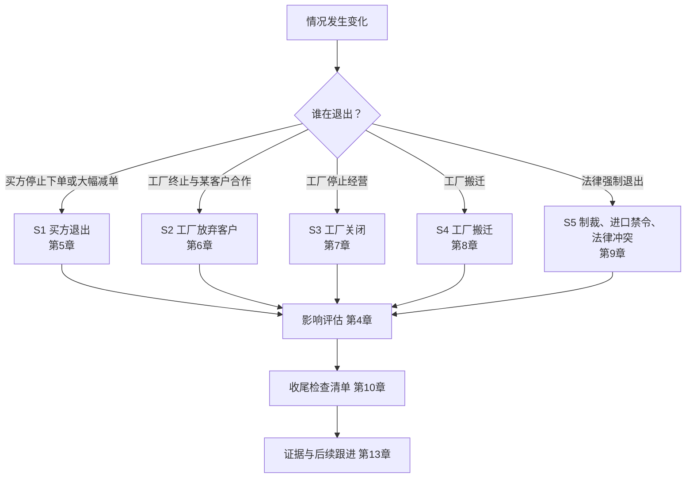

# 负责任退出指南

**终止合作、关厂与搬迁：有序退出，妥善安置职工**

*2026年11月第1版。适用于买方（品牌、进口商、贸易公司）和工厂（老板、人事、财务），特别是中国的中小制造企业。*

::: tip 如何使用本指南
- **时间不多？** 先读核心要点和下面的路线图，再直接看与你相关的情形（第5–9章）。
- **买方准备减单或停止下单？** 看第4、5、10章。
- **工厂失去客户或主动放弃客户？** 看第4、6、10章。
- **工厂关闭或搬迁？** 看第7、8、11章和第14.5节的关厂检查清单。
- **因制裁或进口禁令被迫停止合作？** 看第9章。
- **审核员或验证员？** 看第11、13章。
:::

---

## 核心要点

1. **每一次退出都有成本，问题是谁来承担。** 买方不打招呼就走，或者工厂关门不付经济补偿，成本就落到了职工身上，而职工对这个决定没有任何发言权。
2. **退出有时是对的。** 负责任退出讲的是*怎么*走，而不是规定你必须留下。
3. **预告期要与依赖程度相当。** 你在对方业务中占比越大，预告期就应越长，减量也要越谨慎。对重要买方而言，参考值是六个月。
4. **先把欠的钱付清。** 已生产的货、已采购的物料、工资、经济补偿、社会保险。大多数退出纠纷，争的都是本来就欠着的钱。
5. **在中国，关厂的步骤法律早已规定好了：** 协商、付款、转移、清算、注销。跳过步骤，关厂就可能变成犯罪。
6. **工厂也会退出。** 工厂放弃客户、关闭或迁往国外，对职工承担的责任和离开它的买方是一样的。
7. **迁往国外，在中国劳动法上就是关厂。** 留下的职工应当拿到经济补偿。
8. **制裁和进口禁令可能迫使你快速退出。** 它们限制的是你*能否*留下，而不是你离开时*可以多草率*。
9. **保留证据。** 书面通知、付款记录，退出后六个月内保持申诉渠道畅通。
10. **在需要之前就规划好退出。** 经济补偿准备金、规范的社保记录、合同里的退出条款，在经营好的时候花不了多少钱。

### 五种情形一览

| | 发生了什么 | 买方的角色 | 工厂的角色 |
|---|---|---|---|
| **S1 买方退出** | 买方停止、暂停下单或大幅减单 | 规划并实施退出 | 保护职工、收回款项、补充产能 |
| **S2 工厂放弃客户** | 客户不付款、亏损、终端用途存疑、产能不足 | 确保供应连续、处理模具、做好过渡 | 规划并实施退出 |
| **S3 工厂关闭** | 关闭、解散、破产 | 尽早发现；核实职工已拿到钱 | 按法律规定的步骤关厂 |
| **S4 工厂搬迁** | 同城搬迁、跨省搬迁、迁往国外 | 对新厂重新做资质审核；核实老厂已妥善处理 | 处理好老厂；不在新厂重蹈覆辙 |
| **S5 被迫退出** | 制裁、强迫劳动进口禁令、反制措施 | 在法律允许的空间内尽量减轻影响 | 买方不得不突然停单时，保护好职工 |

---

## 1. 什么是"负责任退出"

### 1.1 名称

**负责任退出**（Responsible exit）是最直白、使用最广的说法。ACT（行动、合作、转型倡议）、Fair Wear（公平服装基金会）、清洁成衣运动、IndustriALL（全球产业工会）以及C&A、Primark、M&S、Inditex等品牌都用这个词，开发银行也用。其他文件用不同的说法表达同一个意思：

| 说法 | 使用方 | 在本指南中的含义 |
|---|---|---|
| 负责任脱离 | 经合组织（OECD）、ETI（道德贸易倡议，2026年） | 同上，也包括大幅减单，而不仅是终止合作 |
| 暂停或终止业务关系 | 欧盟《企业可持续发展尽职调查指令》（CSDDD）、德国《供应链尽职调查法》（LkSG） | 法律用语 |
| 负责任裁员与关厂 | FLA（公平劳工协会）、国际劳工组织（ILO）与国际金融公司（IFC）的Better Work项目 | 工厂一方的说法，着眼于职工 |
| 有序退出、妥善安置职工 | 2016年以来的中国政府政策 | 有序退出并妥善安置职工 |
| 一走了之 | 批评者 | 本指南要避免的做法 |

本指南统一使用**负责任退出**。它涵盖全部五种情形：买方退出、工厂放弃客户、关厂、搬迁和被迫退出。

### 1.2 "负责任"的六层含义

1. **依据事实做决定。** 清楚自己为什么要走，也想清楚留下来是否更有益。
2. **预告期与依赖程度相当。** 一个占工厂产量40%的买方，应当比只占2%的买方给出更长的预告期。
3. **先付清欠款。** 再谈新的索赔、折扣或罚款。
4. **告知受影响的人，并与他们协商。** 包括职工及其代表，而不只是管理层。
5. **事后保持沟通渠道畅通。** 很多问题在最后一张订单之后才浮现。
6. **保留证据。** 这既是为别人，也是在保护你自己。

---

## 2. 退出为什么会出问题：事实说明了什么

### 2.1 买方退出时

- **新冠疫情，孟加拉国，2020年3月。** 一项针对316家供应商的调查发现，订单被取消时，72.1%的买方拒绝支付已采购的原材料费用，91.3%拒绝支付生产成本，97.3%没有为经济补偿提供任何帮助。作者指出，这是在许多品牌已有"负责任退出"政策的情况下发生的。在疫情最初几周，全球约400亿美元的订单被取消或未付款；经过公众运动，后来至少有150亿美元得到支付。*（宾夕法尼亚州立大学全球劳工与工人权利中心（CGWR）与工人权利联盟（WRC），《被抛弃？》，2020年3月；《未付的数十亿》，2020年10月。）*
- **"一走了之"的例子。** 2013年Tazreen工厂大火之后，迪士尼要求被许可方停止在孟加拉国和另外四个国家生产。批评者指出，一走了之对那些仍在这些工厂工作的职工毫无帮助。
- **唯一买方与社会保险。** 危地马拉KOA Modas工厂于2025年2月关闭时，它唯一的买方是Target。在工人权利联盟介入后，约600万美元的经济补偿和拖欠工资得到支付。但另有600万美元的社保扣款，显然已被扣留多年，却从未缴存。*（倡导报告，2026年8月。）* 作为唯一买方，你承担的责任份额更大；而且要查的不只是工资。
- **"分包商"的推脱。** 柬埔寨Violet Apparel工厂于2020年关闭时，拖欠1,280名职工约140万美元，品牌方称该工厂未获授权生产其产品。职工没有其他途径拿到钱。*（人权观察，2023年7月。）*
- **没有一家电子品牌公布退出政策。** SOMO（荷兰跨国企业研究中心）和中国劳工通讯在2024年11月发现，在中国采购的20个主要品牌中，有8个披露了退出政策，全部是服装品牌，电子品牌一个都没有。

### 2.2 工厂关闭或搬迁时

- **按基本工资缴社保。** 2014年东莞裕元，数万名职工因社会保险和住房公积金按基本工资而非全额工资缴纳而罢工，他们担心工厂一旦搬走，差额就再也追不回来。2015年九兴控股（Stella International）的纠纷则是住房公积金欠缴。
- **订单转去国外，却不付经济补偿。** 2024年，东莞一家家具厂把生产转到东南亚，一名54岁的职工被欠8万多元的经济补偿。深圳一家工厂宣布停产六个月而不是裁员，职工说其订单已转去越南。停产期间只发生活费，就可以避开法定经济补偿，职工因此抗议。*（BBC，经商业与人权资源中心（BHRRC）转载；2024年4月媒体报道。）*
- **老板跑路。** 法院经常对欠薪逃匿的老板定罪。2026年4月公布的山东一起案件中，一家纺织公司的经营者拖欠38.97万元后逃匿，被判处有期徒刑六个月并处罚金，公司也被判处罚金。全国范围内，2024年检察机关因拒不支付劳动报酬批准逮捕612人、起诉1,495件，追回欠薪2.44亿多元。*（山东典型案例，2026年4月；最高人民检察院，2025年1月。）*
- **规模。** 2025年冬季根治欠薪专项行动中，有关部门查处欠薪案件28万件，为148万名劳动者追回工资148.3亿元。没有公布其中有多少与关厂有关。
- **工资保障金不管经济补偿。** 2025年，深圳欠薪保障基金为3,965名职工垫付7,242万元，仅从用人单位追回402万元。它垫付的是工资，不是经济补偿。

### 2.3 做得好的例子

- **三星，惠州，2019年。** 三星分阶段关闭了它在中国的最后一家手机工厂。3月停止招工，6月开放带补偿的自愿离职，7月起与其他用人单位在厂内举办招聘会，9月底停产。职工拿到了应发工资、经济补偿和最后一笔住房公积金。
- **索尼，惠州，2024年。** 索尼把精密零部件工厂卖给了新东家。据媒体报道，索尼给员工的补偿远高于法定最低标准（"N+3"）。*（仅有一个二手来源；该数字按报道处理。）*
- **缅甸，2022–2024年。** Primark、M&S、H&M和Inditex按照与全球工会IndustriALL商定的框架，分阶段退出缅甸：不再下新单，完成现有订单，征求职工代表意见，足额支付经济补偿，并要求提供支付凭证。至今没有公布任何对经济补偿实际支付情况的独立审核。
- **Industrial Hana，危地马拉，2023–2025年。** 该工厂关闭时拖欠150万美元经济补偿，三家前买方各支付了50万美元。这花了两年时间，还经历了一场社会运动。
- **Jerzees，洪都拉斯，2009–2010年。** 一家工厂在职工组建工会后关闭。补救不只是赔钱：公司开设了新厂，重新雇用了原来的职工，并承认了工会。
- **中国自己的做法。** 2016年中国化解钢铁、煤炭过剩产能时，中央设立了1,000亿元专项奖补资金，部分按需安置的职工人数分配，并要求"以做好职工安置为重点"。有计划地关停、专款专用安置职工，是中国本土的做法，不是舶来品。

### 2.4 案例的启示

| 启示 | 案例 |
|---|---|
| 关厂后掏钱的品牌，通常是迫于压力，而且来得很晚 | 耐克（洪都拉斯，2010年）、阿迪达斯（印度尼西亚，2013年）、Industrial Hana |
| 要查社保，不只是工资 | 裕元、KOA Modas |
| 唯一买方和主要买方责任更大 | KOA Modas |
| 分包商容易被漏掉 | Violet Apparel |
| 停产可能是规避经济补偿的手段 | 深圳，2024年 |
| 有计划、分阶段关厂是可行的 | 三星惠州、缅甸框架 |
| 补救可以是提供工作，而不只是赔钱 | Jerzees |

---

## 3. 适用的规则

### 3.1 国际规范

| 来源 | 关于退出的规定 |
|---|---|
| **《联合国工商企业与人权指导原则》**（2011年），原则19 | 在影响力无法发挥作用时，可以选择终止关系。要考虑终止关系本身是否会对人造成伤害。 |
| **《经合组织跨国企业负责任商业行为准则》**（2023年更新），第二章评注第25段 | 脱离是最后手段；如果改善切实可行，留下往往更好。"企业决定脱离时，应以负责任的方式进行"，包括协商以及减轻退出影响的措施。 |
| **《经合组织准则》第五章；国际劳工组织《关于多国企业和社会政策的三方原则宣言》** | 关厂涉及集体裁员的，应给予职工代表和主管部门合理预告，并合作减轻影响。 |
| **《经合组织负责任商业行为尽责管理指南》**（2018年），问题39 | 遵守法律和集体合同，向管理层和工会说明理由，给予充分的预告。 |
| **国际劳工组织第158号公约**（中国未批准） | 因经济原因解雇的：告知职工代表并与其协商，尽早通知主管部门，按工龄和工资支付经济补偿。 |
| **联合国人权高专办**，《留下与退出》（2023年） | 不要一见风险就退出。退出带来的声誉好处，并不等于对人更好的结果。 |

### 3.2 影响中国供应商的境外法律

| 法律 | 状态（2026年11月） | 与退出的关系 |
|---|---|---|
| **欧盟《企业可持续发展尽职调查指令》（CSDDD）**，经"综合简化"一揽子法案（Omnibus I，指令（EU）2026/470）修订 | 2026年3月18日生效；成员国须在2028年7月26日前转化为国内法；企业自2029年7月26日起适用。适用范围现约为2,900家欧盟企业（员工5,000人以上且营业额15亿欧元以上）。 | 作为最后手段**终止**关系的义务已被删除。现在的最后手段是**暂停**，且须先评估暂停是否会造成明显更大的伤害。企业须采取措施减轻暂停的影响，给予合理预告，并持续复核该决定。 |
| **德国《供应链尽职调查法》（LkSG）**第7条第3款 | 现行有效；一项减少报告义务、限制罚款的修正案正在议会审议；预计将被CSDDD的转化立法取代 | 只有三个条件同时满足才能终止关系。没有规定如何退出。 |
| **欧盟《强迫劳动产品禁令条例》（EU 2024/3015）** | 2027年12月14日起适用；欧盟委员会指南已于2026年发布 | 禁止使用强迫劳动生产的产品。指南把负责任脱离视为最后手段；在国家强制劳动的情况下，可能是唯一选择。 |
| **美国《维吾尔强迫劳动预防法》（UFLPA）和暂扣令（WRO）** | 现行有效 | 货物被扣留或拒绝入境。2022年的UFLPA战略仍要求进口商减轻对职工的影响，并告知脱离的时间表。 |
| **欧盟《不公平交易行为指令》**（（EU）2019/633） | 现行有效（仅适用于农产品和食品） | 取消易腐产品订单的预告期少于30天的，一律视为"短期预告"，予以禁止。须在30天或60天内付款。可作为食品以外行业的参考基准。 |
| **挪威《透明度法》** | 现行有效；指南于2025年12月更新 | 尽职调查以《经合组织准则》为参照，因此负责任脱离同样适用。 |

### 3.3 行业准则、标准和项目

| 准则或项目 | 有关关厂、裁员或退出的内容 |
|---|---|
| **SA8000:2026**（社会责任国际标准）D3.3、D3.12、D4.11 | 规定最清楚：变动须提前沟通；公平解除合同并及时支付经济补偿；大规模裁员只能作为最后手段；经营连续性中断时，经济补偿和工资优先。 |
| **FLA**工作场所行为准则基准ER.15–16、FOA.8–9；《确保工厂负责任地裁员、退出和关闭》（2023年） | 经济补偿程序；不得以放弃权利作为支付经济补偿的条件；尽早协商；减轻影响的计划；16个问题的供应商检查清单和品牌检查清单。 |
| **ACT**负责任退出政策及检查清单（2022年） | 退出时间表与品牌在工厂产量中的占比相当；职工已拿到钱的证明；与IndustriALL进行调解。 |
| **ETI**《负责任脱离技术指南》（与Shift合作，2026年2月） | 十项原则、四个阶段、影响力决策树、职工已被告知的书面确认、约六个月的后续跟进。 |
| **Fair Wear**《负责任退出策略指南》；品牌绩效评估中关于退出政策的指标 | 至少提前一个季度预告；逐步退出计划；与供应商讨论过退出政策的品牌得分更高。 |
| **C&A**负责任退出政策（2025年12月） | 按订单占比、两年订单量和合作时长进行风险评估；书面决定并附时间表；逐步退出通常为六个月；职工已拿到钱的证明。 |
| **孟加拉国协议**（Bangladesh Accord） | 逐级升级后，公开终止与工厂的关系作为最后一步，24个月后可恢复。 |
| **ILO/IFC Better Work**《转型与裁员管理》 | 面向工厂的手册，附模板，有中文版。 |
| **RBA**（责任商业联盟）**行为准则8.0.1、苹果供应商行为准则（2025年）、amfori BSCI（商业社会责任倡议）、SMETA 7.0（Sedex会员道德贸易审核）、ETI基本准则、Drive Sustainability（汽车行业可持续发展倡议）** | 没有专门关于关厂、经济补偿或退出的条款。电子和一般制造业没有行业性的退出规则。 |
| **SLCP**（社会与劳工融合计划）融合评估框架 | 收集有关解除合同、预告、经济补偿以及裁员前协商的数据；不设定要求。 |

### 3.4 合同条款

- **美国律师协会（ABA）《示范合同条款2.0》**，第1.3(f)条"负责任退出"：买方无论以何种方式终止合同，都应考虑并减轻对人权的影响，给予合理预告，并为已生产的合格货物付款。
- **负责任合同项目（Responsible Contracting Project）《供应商示范条款》**第9条：终止合同的**任何一方**都承担同样的义务。这是唯一一份双向适用的文本。
- **《欧洲示范条款》**（2024年零草案；1.0版即将发布）：义务落在"终止方"身上，无论是哪一方。

### 3.5 中国法律一览

| 事项 | 规则 | 依据 |
|---|---|---|
| 个别经济性解除 | 劳动合同订立时所依据的客观情况发生重大变化、未能就变更达成协议的，提前30日书面通知或额外支付一个月工资 | 《劳动合同法》第40条第3项 |
| 裁员 | 裁减20人以上，或不足20人但占职工总数10%以上的：提前30日向工会或全体职工说明情况，听取意见，向劳动行政部门报告；优先留用；6个月内重新招用的优先招用被裁人员 | 《劳动合同法》第41条；《企业经济性裁减人员规定》（1994年） |
| 受保护职工 | 患职业病或因工负伤、在医疗期内、孕期或哺乳期、在本单位连续工作满15年且距法定退休年龄不足5年的职工，不得依第40条、第41条解除 | 《劳动合同法》第42条 |
| 关厂 | 用人单位被依法宣告破产，被吊销营业执照、责令关闭、撤销或者用人单位决定提前解散的，劳动合同终止 | 《劳动合同法》第44条第4、5项 |
| 经济补偿 | 依第40条、第41条和第44条第4、5项解除或终止的，应支付经济补偿；每满一年支付一个月工资；月工资以当地职工月平均工资3倍为上限，年限最高不超过12年 | 《劳动合同法》第46–47条 |
| 违法解除 | 按经济补偿标准的二倍支付赔偿金 | 《劳动合同法》第48条、第87条 |
| 手续 | 15日内出具解除或终止劳动合同的证明，办理档案和社会保险关系转移手续 | 《劳动合同法》第50条 |
| 停工停产期间工资 | 一个工资支付周期内按正常工资支付；此后不低于最低工资的80%（广东、深圳） | 《工资支付暂行规定》第12条；《广东省工资支付条例》第39条；《深圳市员工工资支付条例》第28条 |
| 注销前清偿工资 | 申请注销前须清偿拖欠工资；否则由主要出资人在注册新用人单位前清偿 | 《保障农民工工资支付条例》第22条 |
| 清算顺序 | 工资、社会保险费用和法定补偿金优先于税款和其他债务 | 《公司法》第236条 |
| 破产 | 职工债权在破产费用之后优先清偿；破产前六个月内支付的工资不得撤销 | 《企业破产法》第113条；《最高人民法院关于适用〈中华人民共和国企业破产法〉若干问题的规定（二）》第16条 |
| 放弃社保的约定 | 约定不缴纳社会保险的，无效（自2025年9月1日起） | 《最高人民法院关于审理劳动争议案件适用法律问题的解释（二）》 |
| 犯罪 | 以转移财产、虚假关闭、逃匿等方法逃避支付劳动报酬；或经政府有关部门责令支付仍不支付 | 《刑法》第276条之一；2013年最高人民法院、最高人民检察院司法解释 |
| 向供应商付款 | 大型企业应自货物交付之日起60日内向中小企业付款；不得约定"背靠背"付款条款（自2025年6月1日起） | 《保障中小企业款项支付条例》（国务院令第802号） |
| 终止商业合同 | 协商解除或因根本违约解除；情势变更 | 《民法典》第533条、第562–566条 |

### 3.6 可能出现的新变化

- **CSDDD转化为国内法（2026–2028年）。** 各国法律可能对如何暂停作出更细的规定。欧盟委员会关于示范合同条款的指引预计于2027年初发布。
- **欧盟《强迫劳动产品禁令条例》（2027年12月起）。** 预计产品禁令会引发对被标记地区和供应商的突然集体退出。风险数据库仍在建设中。
- **全球经济补偿保障基金。** "给工人发工资"联盟（Pay Your Workers，获260多个组织支持）提议，品牌通过在订单上加价来出资设立经济补偿保障。截至2026年11月，尚无品牌签署。
- **国际劳工组织。** 成员国正在讨论是否制定供应链体面劳动标准；尚未确定议程。
- **中国。** 《企业破产法》修订草案已于2026年8月二审通过，尚未正式通过。《劳动合同法》未列入2026年立法工作计划。
- **英国。** 2026年6月提出的一项法案将强制要求现代奴役报告并设定处罚，但不涉及尽职调查。
- **欧盟《延迟付款条例》。** 已陷入停滞；欧盟委员会已表示可能撤回。

---

## 4. 任何退出之前：影响评估

无论哪一方退出，都要在最终决定之前做这项评估。小工厂做一次大约需要半天，这是防止退出出问题的最有效办法。评估结果决定预告期多长、要为哪些事情付钱。

### 4.1 要问的问题

| 方面 | 买方要问 | 工厂要问 |
|---|---|---|
| **依赖程度** | 过去12个月我们占工厂产量的多少？还有谁在这家工厂下单，他们是否也在撤？ | 这个客户占我们营收的多少？有多少条生产线、多少个班次、多少人主要在做它的订单？ |
| **人员** | 多少职工会失去工作或工时？他们是谁：外来务工人员、年龄较大的职工、孕期职工、年轻职工、家庭工？在厂里干了多久？ | 同样的问题，从工资表里查。哪些职工受保护、不能经济性解除（《劳动合同法》第42条）？ |
| **欠款** | 未完成订单、在制品、成品、为我们采购的物料、到期发票、我们打算提出的索赔。 | 应收账款、为客户采购的物料、已印刷的包装、模具、押金，以及订单量下降时我们自己要承担的经济补偿。 |
| **法定欠缴** | 工厂是否按全额工资缴纳社会保险和住房公积金？（如果没有，一旦关厂，差额就会变成纠纷。） | 同样的问题，对自己老实回答。 |
| **时机** | 是旺季还是淡季？是否临近春节？其他买方是否也正在撤出同一地区？ | 我们能补上产能吗？新客户的第一张订单要多久才能来？ |
| **替代方案** | 我们能否留下来，用影响力推动改善？能否暂停而不是终止？能否逐步减量？ | 能否重新谈价格或条款，要求付款担保，或者把这个客户的份额减少？ |

### 4.2 从评估结果到预告期

买方退出没有法定的统一期限。参考下面的标准，依赖程度越高，预告期越长。

| 买方占工厂产量的比例 | 参考预告期和减量安排 | 依据 |
|---|---|---|
| 10%以下 | 至少一个完整的订单周期或季度（约3个月） | Fair Wear："至少提前一个季度" |
| 10–30% | 6个月，并提供书面的订单量预测 | FLA 2023年品牌检查清单：不得少于六个月 |
| 30%以上，或工厂是唯一或主要供应商 | 6–12个月，分阶段进行，承诺最后几批订单，并核实经济补偿有能力支付 | ACT：时间表与订单占比相当；ETI 2026年计划内容 |
| 因严重侵权而退出 | 预告期可以缩短，但减轻退出伤害的义务仍在 | 《经合组织尽责管理指南》问题39及脚注20；经修订的CSDDD |

对工厂一方来说，底线就是法律：个别经济性解除须提前30日书面通知（《劳动合同法》第40条第3项）；裁减20人以上或占职工总数10%以上的，须提前30日向工会或全体职工说明情况（《劳动合同法》第41条）。与客户之间的商业预告期由合同约定。

---

## 5. 情形一：买方退出

**常见原因：** 价格、质量、转移到其他国家、精简供应商、审核不通过、买方自己的业务萎缩，或者进口禁令。

### 5.1 决策

1. **把理由和依据写下来。** 如果理由是人权问题，先想清楚留下来推动改善是否更有益。经合组织和经修订的CSDDD都把终止关系视为最后一步，前面还有暂停新订单和强化行动计划。
2. **做影响评估（第4章）。** 不做评估，预告期就只能靠猜。
3. **看看别人是否也在退出。** 如果其他买方同时在撤出同一家工厂或同一地区，叠加起来可能导致工厂倒闭。ETI称之为累积影响。
4. **做出选择：** 留下来推动改善；在执行计划期间暂停新订单；逐步减量；或者终止。

### 5.2 实施

1. **书面通知**，写明理由、时间表，以及到最后一张订单为止每个月的订单量预测。发给工厂管理层，并请他们转告工会或职工代表。
2. **付清欠款。** 符合约定质量的成品和在制品；为你的订单采购的物料；按时支付发票。不要借退出之机提出新的索赔或压价。
3. **问工厂打算如何应对订单减少。** 如果要裁员，要求工厂提供第41条规定的裁员方案和经济补偿测算。主动提出提前支付尾款，让工厂有钱支付经济补偿。
4. **保留你需要的工厂资料**（审核报告、纠正行动计划），并商定共享数据如何处理（见第10章）。
5. **拿到证据。** 职工已被告知的书面确认、工资和经济补偿的支付记录，如有裁员报告，还要有劳动行政部门的回执。

### 5.3 最后一张订单之后

- 对工厂职工的申诉渠道保持开放约**六个月**（ETI 2026年）。
- 如果事后得知职工没拿到钱，要采取行动。ACT的做法是在付尾款之前与工会进行调解；尾款付清之后，你手里就只剩声誉方面的影响力了。

### 5.4 常见错误

- 在最后一张订单前一周才发邮件通知工厂。
- 取消已经在生产的订单，拒绝支付物料费用。（2020年3月，72%的买方就是这样对待孟加拉国供应商的。）
- 网站上挂着负责任退出政策，采购团队却从来没看过。
- 通过代理商把订单转到另一家工厂，并认为"这不算我们退出"。ACT将其视为品牌的退出。

---

## 6. 情形二：工厂放弃客户

这种情形几乎没有公开的指引。工厂主动终止客户的情况，比买方以为的要多。

**常见原因：**
- 客户不付款，或者付款越拖越久。
- 价格已经覆盖不了工资和法定福利。
- 客户要求做违法或不安全的事：超时加班、做假记录、生产在目的地违法的产品。
- **终端用途存疑。** 你发现自己的零部件被用在销售地违法或有害的产品上。
- 需要把产能留给更好的客户。

> **案例（已匿名，来自作者本人的工作）：** 一家塑料厂为一个客户生产空容器，后来才知道，客户把容器运到加拿大，灌装含添加剂的尼古丁烟液。加拿大把即使是空的容器也当作电子烟部件监管，并禁止咖啡因、维生素、牛磺酸等添加剂。中国《电子烟管理办法》第33条要求，仅用于出口的产品须符合目的地国家的法律。这家工厂从未核查过客户的终端用途。它面临的是法律、商业（货物被扣、货款收不回）和声誉三方面的风险。

### 6.1 决策

1. **把事实弄清楚。** 付款记录；客户的书面指示；从客户自己的单据中查明目的地和终端用途。
2. **查合同。** 预告期、解除事由，以及模具、未完成订单和库存如何处理。
3. **合同没有约定的，看《民法典》的规定：** 协商解除，或因根本违约依法解除，例如经合理催告后仍不付款（《民法典》第562–566条）；情势变更（第533条）。
4. **对自己的职工做影响评估。** 如果失去这个客户意味着要裁员，第41条的时间表现在就开始算，而不是等到最后一批货发出去才算。
5. **决定是否完成未完成的订单。** 完成合法订单，能保住职工的工资，也能保住你的债权。如果订单本身违法，就必须停止，没有选择余地。

### 6.2 实施

1. **发出书面通知**，写明理由、最后一张订单的日期，以及你对库存、模具和款项的处理方案。
2. **保住你的钱。** 要求最后几批货发货前付款、支付定金或开立信用证。客户经营出问题的，要及时申报债权。
3. **工资优先。** 如果原因是客户不付款，不要让它变成你拖欠职工工资。动用你的经济补偿准备金（第7章），资金紧张时尽早与劳动行政部门沟通。
4. **先调岗，再解除。** 把职工调到其他生产线；提供培训；先减少加班，再考虑裁员。
5. **移交或归还**模具、技术文件和样品，按约定办理，并让对方签收（第10章）。
6. **告知其他客户**，如果他们的订单要换生产线或改交期。

### 6.3 常见错误

- 客户付款晚了，就不打招呼直接停产，结果被告违约。
- 没有法律依据，扣着客户的模具当担保。
- 到最后一批货发运时才发现有80名职工靠这个客户吃饭，而裁员程序一项都没启动。

---

## 7. 情形三：工厂关闭

依法关厂花钱多，但结果可以预期。不依法关厂，老板就可能走上刑事法庭。

### 7.1 步骤

1. **作出决定并留下记录。** 由股东会或出资人作出解散决议，写明理由。决定前听取工会和职工的意见（《公司法》第17条）。
2. **宣布前先自查欠缴。** 把过去两年社会保险和住房公积金的缴费基数与实际工资对比一下，现在就把差额补上。在裕元（2014年）和九兴（2015年）的罢工中，只按基本工资缴费的问题，正是在职工担心工厂搬迁时才爆发的。自2025年9月1日起，职工放弃社会保险的约定一律无效（最高人民法院《解释（二）》）。
3. **备足经济补偿准备金。** 测算：截至最后一天的工资、停工停产期间工资、第46–47条规定的经济补偿、未休年假、代替预告的一个月工资、社会保险和住房公积金欠缴。宣布之前把钱留出来。
4. **说明情况并协商。** 涉及20人以上或占职工总数10%以上的，提前30日向工会或全体职工说明情况，听取意见，并向劳动行政部门报告裁员方案（《劳动合同法》第41条；1994年《企业经济性裁减人员规定》）。依第44条第5项解散的，劳动合同终止，但仍须支付经济补偿（第46条）。
5. **保护受保护的职工。** 在医疗期内的、患职业病或因工负伤的、孕期或哺乳期的，以及连续工作满15年且距法定退休年龄不足5年的职工，不得依第40–41条解除（第42条）。解散时，对这些职工要逐一咨询法律意见。
6. **工资发到最后一天**，并支付停工停产期间工资。在广东和深圳：停工停产的第一个工资支付周期按正常工资支付，此后不低于当地最低工资的80%，直到复工或劳动关系结束。
7. **支付经济补偿：** 每满一年支付一个月平均工资；六个月以上不满一年的，按一年计算；不满六个月的，支付半个月工资。高收入者的月工资基数以当地职工月平均工资3倍为上限，年限最高不超过12年（第47条）。
8. **15日内办妥手续：** 出具解除或终止劳动合同的证明，办理档案和社会保险关系转移（第50条）。7日内向社会保险经办机构报送失业人员名单。
9. **按法定顺序清算：** 先支付清算费用，再支付职工工资、社会保险费用和法定补偿金，然后缴纳税款，最后清偿其他债务（《公司法》第236条）。破产的，职工债权同样在破产费用之后优先清偿（《企业破产法》第113条）。
10. **最后才注销。** 申请注销前必须清偿工资；否则主要出资人须在注册新用人单位前清偿（《保障农民工工资支付条例》第22条）。简易注销以全体股东承诺无债务为前提；承诺不实的，承担连带责任（《公司法》第240条）。
11. **书面告知客户**，写明关厂日期、最后一批货的发运时间，以及关厂后的联系人。

### 7.2 什么情况下关厂会变成犯罪

根据《刑法》第276条之一及2013年的司法解释，以**转移财产、虚假关闭或虚假破产、逃跑或藏匿、销毁工资账册**等方法逃避支付劳动报酬，数额较大的（视各省标准，低至拖欠一名职工三个月工资5,000元，或拖欠十名职工3万元），或者经政府责令支付仍不支付的，构成犯罪。在提起公诉前支付的，可以减轻或免除处罚（第6条）。拖欠工资期间连夜把机器运走，正是司法解释点名的行为。

### 7.3 钱不够怎么办

- 在工资拖欠**之前**就找劳动行政部门，而不是等到拖欠之后。政府有办法：承租经营者逃匿的，广东可以先行垫付临时生活费用（《广东省工资支付条例》第31条）；县级政府可以动用应急周转金（《保障农民工工资支付条例》第63条）；老板逃匿或破产申请被受理时，深圳欠薪保障基金按全市平均工资的60%垫付最多六个月工资。**这些都不包括经济补偿。**
- 找你的买方。有些买方会提前付款，或者提前为成品付款，帮你筹措经济补偿。最糟糕的求助时机，是职工已经开始抗议之后。
- 破产是一条法律途径，不是失败。破产程序让职工债权优先受偿。

---

## 8. 情形四：工厂搬迁

### 8.1 决策树

| 搬迁方式 | 法律上的含义 | 怎么做 |
|---|---|---|
| **同城、近距离搬迁**，并有补救措施（班车、交通补贴、宿舍） | 通常不构成支付经济补偿的理由。法院会综合考虑距离、通勤时间和提供的补救措施。 | 尽早协商；书面提供补救措施；让职工真正有选择；对搬迁确实不合理的职工支付经济补偿。 |
| **跨市或跨省搬迁** | 对大多数职工而言，属于"劳动合同订立时所依据的客观情况发生重大变化"（《劳动合同法》第40条第3项）。未能达成新协议的，解除合同并支付经济补偿。 | 书面提出调动条件；不愿调动的支付经济补偿；涉及20人以上或10%以上的，走第41条程序。 |
| **迁往国外**（越南、柬埔寨、印度尼西亚等） | 在劳动法上不算搬迁，而是中国用人单位的关闭或大规模裁员（第41条、第44条第5项、第46–47条）。 | 完整执行第7章的关厂步骤。 |
| **职工转到关联企业** | 非因本人原因被安排到新单位的，工作年限连续计算（《劳动合同法实施条例》第10条）。 | 在新合同中写明工龄连续计算；未经职工知情同意，不要先结清补偿再重新起算工龄。 |

### 8.2 不要在国外重蹈覆辙

新厂址同样存在这些责任。在越南，因重组或经济原因被解雇的职工，可按每工作一年一个月工资领取失业津贴（最少两个月）。在柬埔寨，工龄补偿每年累计两次。从第一天起就要把将来关厂的成本纳入新厂预算；采矿业把这叫作闭矿规划，在动第一铲土之前就做好了。

### 8.3 买方怎么做

- 把新厂当作新供应商重新做资质审核：审核、证照、分包情况。
- 要求提供老厂已妥善处理的证据：经济补偿支付记录、社保清缴证明、劳动行政部门的回执。
- 老厂职工的钱还没付清，就不要让"新"厂给你供货。

---

## 9. 情形五：制裁、进口禁令和法律冲突导致的被迫退出

有时候，留不留，由法律说了算。供应商一旦被列入制裁名单，从当天起继续与其交易就可能违法。强迫劳动进口禁令可能让它的货卖不出去。中国的反制措施又可能让退出本身成为法律风险。此外，从竞争法到数据保护，其他一些法律也与负责任退出的要求相互掣肘。

联合国人权事务高级专员办事处用一句话说明了原则：在适用制裁或进口禁令的情况下，企业"可能负有迅速切断关系的法律义务"。在企业对**如何**退出（而非**是否**退出）仍有自主空间的范围内，负责任退出的建议仍然适用。*（OHCHR，Remaining and Exiting，2023，第9页。）* 本章讲的就是这个"如何"。

### 9.1 制裁（资产冻结和贸易禁令）

**法律要求。** 供应商或其所有人一旦被列入美国财政部外国资产控制办公室（OFAC）、欧盟或英国的资产冻结名单，与其交易立即成为违法行为，除非取得许可。不得"直接或间接"向其提供任何资金。允许支付的款项，通常须付入冻结账户。

**收尾窗口期。** 监管机构通常会发布一般许可，允许企业收尾现有业务，期限一般约为**30天**，偶尔为60–90天。在窗口期内，只允许进行退出"通常附带且必要"的交易，不得开展新业务。欧盟对俄罗斯的行业制裁采用了"X日前签订的合同可履行至Y日"的条款；在涉及供应安全的情况下，欧盟委员会自己的常见问题解答建议给予"例如60天"的收尾期。

**支付工人工资。** 这是制裁与负责任退出冲突最激烈的地方。替被列名供应商支付工资或经济补偿，等于替这家公司清偿债务，很可能构成向其"提供资金"。2018年，OFAC对俄铝（Rusal）的许可只允许在收尾期内支付工资和养老金。2022年，英国为在俄罗斯收尾业务的企业发布了一般许可，明确将**"员工工资"**列为允许的用途。除此类文本外，需要申请**特别许可**。

**制裁情形下的负责任退出：**
1. 第一天就把所有未完成订单、付款和合同与许可窗口期逐一对照。
2. 用足整个窗口期，有序完成最后一批出货，并依法支付已生产货物的货款。
3. 立即书面通知供应商：终止日期由法律决定，而非我方选择。
4. 立即申请特别许可，用于支付未结发票并分担工资或经济补偿。保护工人是被认可的申请理由。
5. 记录无法提前通知的原因，以及采取了哪些替代措施。
6. 退出后，只通过不会使被列名公司受益的渠道支持工人，且须事先取得法律意见。

### 9.2 强迫劳动进口禁令

**法律要求。** 根据美国暂扣令（WRO），货物会被扣留，可被退运出境或没收。根据《维吾尔强迫劳动预防法》（UFLPA），与新疆或被列名实体有关的货物，被推定为使用强迫劳动生产，除非进口商以"清晰且令人信服的证据"证明并非如此。自2027年12月14日起，欧盟《强迫劳动产品禁令条例》将禁止此类产品进入欧盟市场，并要求召回已售出的产品。

**整改可以替代退出。** 强迫劳动一旦消除，进口禁令即可解除。最有名的案例：
- **Top Glove（马来西亚，2020–2021年）。** 其手套被禁后，公司向工人支付了超过3000万美元，主要用于偿还招聘费。美国海关于2021年9月修改了禁令。
- **Sime Darby Plantation（马来西亚，2020–2023年）。** 约2000万美元被专门用于偿还招聘费。禁令于2023年2月修改。

这两个案例中，留下来解决问题帮助了工人；一走了之则会让工人继续背负债务。

**无法整改时。** 对于国家强加的强迫劳动，美国和欧盟的指引都承认退出可能是唯一选择。即便如此，2022年UFLPA战略仍要求进口商"在可能的情况下"减轻对工人的影响，包括将决定和时间表告知供应商和工人。欧盟指南（2026年）将负责任脱离描述为最后手段。

**进口禁令情形下的负责任退出：**
1. 先问清楚：强迫劳动是雇主造成的，还是国家强加的？如果是雇主造成的，推动整改（退还费用、归还证件、纠正工时），以此作为解除禁令的途径。
2. 如果必须退出，在法律允许的范围内支付已生产货物的货款，并在法律允许的范围内提前通知。
3. 避免因突然取消订单把成本转嫁给供应商的其他工人。
4. 预计会出现**集体退出**：禁令对所有买家同时生效。可以与其他买家协调退出方式，但须注意9.4关于竞争法的内容。

### 9.3 中国的反制措施

中国法律将某些受外国因素驱动的退出视为违法：

| 规定 | 主要内容 | 与退出的关系 |
|---|---|---|
| **《反外国制裁法》**第12条（2021年） | 任何组织和个人不得执行或协助执行外国对中国公民、组织采取的歧视性限制措施。受到侵害的，可以向中国法院起诉，要求停止侵害、赔偿损失。 | 因外国措施而断绝与中国供应商往来的买家，可能在中国被起诉。 |
| **《实施〈反外国制裁法〉的规定》**（国务院令第803号，2025年） | 增加了约谈和责令改正（第17条），确认了起诉权（第18条），并允许禁止向被列名方提供数据或个人信息（第9条、第13条）。 | 退出时，数据和记录可能受到限制。 |
| **《反外国不当域外管辖条例》**（国务院令第835号，2026年4月13日施行） | 禁止执行或协助执行不当域外管辖措施（第6条），赋予起诉权（第14条），规定了处罚（第17条）。 | 适用于因遵守外国法律而退出的情形。 |
| **《不可靠实体清单规定》**（商务部，2020年）第2条 | 针对"违反正常的市场交易原则"、中断与中国企业正常交易的外国实体。 | 不加解释的一刀切退出，正是该条所描述的行为。PVH于2024年9月因其涉疆措施被调查，2025年2月被列入清单。 |
| **《阻断外国法律与措施不当域外适用办法》**（商务部，2021年） | 中国当事人遇到外国措施限制其正常经贸活动的，须在30日内报告；商务部可发布禁令，禁止遵守；可提起损害赔偿诉讼。 | 迄今尚未公开发布过禁令。 |

**法院判例。** 2026年公布的一起案件中，上海一家法院认定遵守美国制裁不能作为违约的抗辩理由，判决赔偿全部货值。*（由律师事务所报道；细节应视为二手信息。）* 迄今尚无中国供应商因强迫劳动相关退出起诉外国**买家**的公开案例。

**反过来也一样。** 中国的反制措施也可能迫使**中国供应商**突然停止向外国客户供货，2024年10月一家美国无人机企业的电池供应就是如此。供应商的工人面临的订单损失，与任何买家退出并无二致。

**此类情形下的负责任退出：**
1. 决策依据应是**针对具体供应商、有书面记录的尽职调查结论和商业理由**，而不是笼统的"X法律禁止Y地区"。
2. 按合同提前通知，并付清所有欠款。已足额收款的供应商，可主张的权利要少得多。
3. 有整改途径的，优先走整改途径。
4. 就退出的措辞和沟通方式征询中国律师的意见。
5. 对工厂而言：如果买家因外国法律原因退出，你在中国可能有救济途径。但你对自己工人的义务，不会因为起因是外国法律而改变。

### 9.4 与负责任退出相互掣肘的其他法律

| 规定 | 负责任退出的要求 | 冲突 | 如何协调 |
|---|---|---|---|
| **竞争法**（欧盟第101条；中国《反垄断法》） | 与其他买家协调，减轻叠加影响 | 相互竞争的买家约定停止向某供应商或某地区采购，构成集体抵制 | 只约定退出**如何**进行（通知、经济补偿核实、共用申诉渠道），绝不约定**是否退出或何时退出**。IndustriALL缅甸框架（2023年）对此有明确表述。请第三方主持协调，保留会议纪要，征询反垄断法律意见。 |
| **数据保护**（《个人信息保护法》第38–39条；《数据安全法》第36条） | 核实工人已获支付；共享记录 | 向境外提供工人名单或工资表，需履行告知义务并取得单独同意；未经中国主管机关批准，不得向外国机构提供记录 | **在中国境内**核实：由境内审核员核查工资表；只有汇总或匿名化的结果出境。退出前删除不需要的数据。 |
| **破产法**（《企业破产法》第31–32条、第40条） | 协助确保工人获得支付 | 破产前不久向个别债权人的清偿可能被撤销（追回）；抵销受到限制 | 工资和工伤赔偿款受到保护（《最高人民法院关于适用〈企业破产法〉若干问题的规定（二）》第16条）。**先付工人，不先退买家的款**。买家直接向工人付款的，应依据工厂的书面指示进行，最好通过共管账户或三方协议。不要从陷入困境的供应商的最后几笔发票中扣款。 |
| **反贿赂和反洗钱** | 尽快把钱交到工人手里 | 在危机情况下经代理人或中间人付款，风险很高 | 通过银行转账直接付给具名工人，或通过工会或非政府组织发放，并对发放过程进行审计。核查收款人。不得经代理人支付现金。 |
| **不可抗力** | 减轻退出的影响 | 法定免责事由（制裁、疫情）可以解除合同义务 | 有效的免责事由限制的是你**能**做什么，而不是你**应当**尽力做什么。新冠疫情已经显示，用它来拒付已完工货物的货款会造成什么后果。 |
| **东道国法律**（例如俄罗斯的退出折价和"自愿捐款"；缅甸对买方的审批） | 出售给负责任的买方；保护员工 | 国家决定价格、买方或时间 | 进入市场时就规划退出情景。2025年，挪威OECD国家联络点认定Telenor出售其缅甸业务并移交用户数据时"没有退出策略"；该联络点表示，退出规划应从进入市场时开始。 |
| **业务连续性**（"更换供应商"） | 提前通知和协商 | 业务连续性管理（BCM）追求速度 | 在更换供应商的决策中增加影响评估环节（第15章）。 |

### 9.5 被迫退出时要问的问题

- 是哪部法律迫使我们退出？从哪天开始？有没有许可窗口期？
- 我们还能合法支付哪些款项：成品、材料、工资、经济补偿？是否需要特别许可？
- 强迫劳动是雇主造成的（可以整改），还是国家强加的？
- 我们的退出或退出措辞，在中国是否可能被视为执行外国歧视性措施？
- 其他买家是否同时退出？我们协调的是否只限于"如何退出"？
- 我们需要保留哪些记录？这些记录能否合法出境？
- 如果与工人的协商受到限制，由谁、以什么方式通知工人？

---

## 10. 商业收尾：双方清单

负责任退出的工具大多只谈工人，谈完就结束了。实际上，大部分退出纠纷都起于库存、模具和钱。尽快把这些事情了结，才能腾出现金支付工人。每一项都要书面确认。

| 事项 | 需要明确的问题 | 买家的责任 | 工厂的责任 |
|---|---|---|---|
| **未完成采购订单** | 哪些订单做完，哪些取消？ | 书面确认；为做完的订单付款 | 按约定标准完成；被取消的订单立即停工，控制成本 |
| **在制品和成品** | 由谁付款？按什么价格？ | 为按你的订单和质量要求生产的货物付款 | 提供附照片和日期的库存盘点 |
| 为该客户采购的**原材料和零部件** | 采购是否经授权（预测、最小起订量、指定供应商）？ | 为按你的指示采购的材料付款，或接收这些材料 | 出示采购订单和发票；先设法自用或转售 |
| **品牌包装、标签、印刷品** | 销毁、退回还是移交？ | 作出决定并承担相关费用 | 销毁并出具证明，或退回；绝不出售带品牌的货物 |
| **模具、工装治具、测试夹具** | 归谁所有？谁付的钱？运去哪里？ | 取回、支付仓储费，或授权销毁 | 凭签字收据退还；不要把模具扣作非正式担保 |
| **知识产权、技术文件、样品、规格书** | 退回还是销毁？ | 要求退回或出具销毁证明 | 退回或销毁并出具证明；只保留法律要求保留的内容 |
| **款项** | 最终发票、抵销、押金、扣款、返利 | 按时付款；退出时不提出新的索赔 | 及时开票；对逾期款项书面催收 |
| **审核数据和平台权限** | 审核报告和纠正措施计划由谁保留？平台连接（SLCP、amfori、Sedex）是否继续共享？ | 保留自身记录所需的内容；合作结束后停止常规访问 | 决定继续向谁共享；评估结果归你所有 |
| **工人个人信息** | 是否向买家或审核员提供过工人名单、工资表摘录或身份证件？ | 删除不再需要的信息；不得再向他人转移 | 只在法律允许的范围内共享（《个人信息保护法》）；尽可能匿名化 |
| **与该客户相关的证书和许可** | 客户资助的认证、产品注册、出口许可、品牌授权 | 按要求通知认证机构和主管部门 | 更新证书范围；停止使用客户的商标 |
| **退出后的联系人** | 最后一批出货后，由谁回答问题？ | 指定一名联系人，负责六个月 | 指定一名联系人；按法定保存期限保留记录 |

---

## 11. 预警信号：工厂可能走向糟糕退出的迹象

供买家、审核员和代理商使用。出现一个信号，值得问一问。出现两个或以上，就应立即行动：与老板面谈，核查记录，必要时提前付款，确保工资和经济补偿能够支付。

| 预警信号 | 在哪里核查 | 为什么重要 |
|---|---|---|
| 工资拖欠一个月或以上；只发部分工资 | 工资记录；工人访谈；工人在社交媒体上的帖子 | 欠薪是最早、最可靠的信号 |
| 社会保险或住房公积金只按基本工资缴纳，或存在欠缴 | 将缴费明细与工资表对照 | 工人一旦听说关厂或搬迁，就会演变成群体性纠纷 |
| 机器设备或库存被运走，尤其是在夜间或节假日 | 现场走访；周边邻居；保安值班记录 | 这正是2013年关于《刑法》第276条之一的司法解释所列明的行为 |
| 拖欠房租；与房东有纠纷；房东负债 | 房东；法院记录；不动产登记 | 房东的债权人可能查封厂房 |
| 法定代表人或老板联系不上 | 反复打电话和上门 | 逃匿是犯罪构成要件之一，也是触发深圳欠薪保障基金的条件 |
| 同一批股东在境外注册了新公司，或订单转移到"兄弟"工厂 | 企业登记信息；海关数据；老板本人的说法 | 不清理老厂就搬迁 |
| 有法院执行案件、银行账户被冻结 | 中国执行信息公开网（zxgk.court.gov.cn）；国家企业信用信息公示系统（gsxt.gov.cn） | 债权人已经在排队 |
| 发布了简易注销公告 | gsxt.gov.cn公告 | 股东在声明已无未清债务 |
| 突然停止招工；先是大量加班，然后完全没有加班 | 工人访谈；流失率数据 | 资金链或订单断崖 |
| 施压工人"自愿"辞职 | 工人访谈；成批出现、日期相同的辞职表 | 规避经济补偿 |

---

## 12. 要问的问题：谁、什么、为什么、何时、如何

开会时使用。不同角色问不同的问题，合起来覆盖整个退出过程。

### 12.1 买家：采购和管理层

- **为什么**要退出？是商业原因，还是一个留下来仍然可以解决的人权问题？
- 我们占这家工厂产量的**多少**？还有谁在这里采购？他们也要走吗？
- 工厂的旺季或春节在**什么时候**？我们选的时间是不是对工人最不利的？
- 如果我们的订单没了，工厂**如何**支付经济补偿？我们的最后几笔付款，是在工厂裁员之前到账还是之后？
- 工厂里**谁**、工人中**谁**，是直接从我们这里听到这个消息的？
- 如果这次退出被写进报纸、署上我们的名字，我们能坦然面对吗？

### 12.2 买家：法务和合规

- 有没有哪条制裁或进口禁令规定要求我们立即停止？如果有，我们还能合法支付什么？
- 因外国法律原因停止与中国供应商交易，是否会使我们面临《反外国制裁法》或《不可靠实体清单规定》的风险？我们征询过法律意见吗？
- 哪些合同条款（终止、不可抗力、模具、知识产权、数据）适用？
- 根据修订后的欧盟《企业可持续发展尽职调查指令》（CSDDD）、德国《供应链尽职调查法》（LkSG）或我们自己的政策，监管机构会期望我们保留哪些记录？

### 12.3 工厂：老板和财务

- 如果这个客户明天就走，我们能支付几个月的工资和经济补偿？
- 我们的社会保险和住房公积金是否按全额工资缴纳？如果不是，缺口有多大？
- 哪些客户欠我们钱？其中有没有经营出问题的？
- 厂房是自有的吗？如果不是，房东财务状况是否稳健？租赁合同有没有登记备案？
- 如果搬迁，我们是否为每一位不随迁的工人核算了经济补偿？

### 12.4 工厂：人力资源

- 有多少工人会受影响？其中哪些人受法律保护、不得被经济性裁员？
- 是否达到第41条的门槛（20人以上或10%以上）？30天的说明期应从何时开始？
- 每位工人过去12个月的平均工资是否已经准备好？
- 离职证明、档案转移和失业人员名单，是否已经安排好在事后几天内办理？

### 12.5 工人及其代表

- 什么时候、由谁书面通知我们？
- 我的经济补偿怎么算？什么时候支付？
- 我的社会保险缴足了吗？会办理转移吗？
- 如果拿不到钱，我该打谁的电话？（12333；当地劳动保障监察大队；买家的申诉渠道。）

### 12.6 审核员和验证员

- 解除劳动合同和经济补偿的记录，与工资表和银行流水是否一致？
- 工厂是否就裁员的替代方案征求过工人意见？
- 工厂的人数变化趋势、加班模式或工资发放时间，是否显示企业经营承压？
- 工厂的回答或文件中，是否有迹象表明存在尚未宣布的关厂计划？

---

## 13. 证据：哪份文件证明哪一步

| 步骤 | 证据 | 对应的标准条款 |
|---|---|---|
| 决策有书面记录 | 老板决定或董事会决议；理由；影响评估 | SA8000:2026 D3.12；FLA ER.16 |
| 已告知并征求工人意见 | 注明日期的通知；与工会或工人代表的会议纪要；第41条报告及劳动行政部门的回执 | SA8000 D3.3；FLA ER.16、FOA.8–9；国家法律 |
| 经济补偿计算正确 | 每位工人的计算表（工资基数、工作年限、封顶） | SA8000 D3.12(c)；FLA ER.15 |
| 工资和经济补偿已支付 | 银行转账记录或签字收据；工资表 | SA8000 D3.12(c)、D4.11；FLA ER.15；RBA A.4（法定福利）；amfori BSCI公平报酬 |
| 未要求放弃权利 | 审查和解协议中是否有放弃法定权利的条款 | FLA ER.15（不得以放弃权利作为支付经济补偿的条件） |
| 社会保险已结清并转移 | 缴费明细；转移回执 | SA8000；国家法律；SLCP CAF中关于解除劳动合同和福利的问题 |
| 手续文件已出具 | 解除劳动合同证明；档案转移记录 | 国家法律（《劳动合同法》第50条） |
| 买家已付清欠款 | 成品、在制品和材料的付款记录 | ACT；ETI 2026；MCC 2.0 §1.3(f) |
| 申诉已处理 | 退出后六个月的申诉记录 | ETI 2026 |

---

## 14. 模板

以下为可修改使用的简短双语模板。替换方括号中的内容；请核对当地法律。

### 14.1 买家致工厂：退出通知

> **Subject: Notice of phased end of orders / 关于逐步终止订单的通知**
>
> [工厂名称]：
>
> 双方合作[期间]以来，承蒙支持。经研究，我司决定[终止 / 减少]对贵司的订单。原因是[原因]。
>
> **时间安排：** 我司最后一张采购订单将于[日期]下达，并于[日期]前出货。在此之前的预计月度订单量见附件预测表。
>
> **付款：** 对于按我司订单生产的全部货物和在制品，以及按我司指示采购的材料（见附件清单），我司将于[日期]前付清。
>
> **贵司员工：** 请将本通知告知贵司工会或员工代表。如此次变化将导致裁员，请于[日期]前将裁员方案和经济补偿计算表发送给我司。我司愿意商讨提前付款，提供帮助。
>
> **最后一张订单之后：** [姓名]将继续担任贵司的联系人，至[日期，约六个月后]。

### 14.2 工厂致客户：终止供货通知

> **Subject: Notice of termination of supply / 关于终止供货的通知**
>
> 根据[合同条款 / 《民法典》]，我司特此通知：我司将于[日期]停止供应[产品]。原因是[原因：自某日起逾期未付款人民币x元 / 最终用途存疑 / 产能原因]。
>
> 未完成订单[清单]将[在预付货款后完成并出货 / 取消]。库存、材料和模具清单见附件；请于[日期]前确认取回、购买还是授权销毁。未结发票金额人民币[金额]元，请于[日期]前支付。

### 14.3 工厂致员工：裁员说明（《劳动合同法》第41条）

> **Notice to all staff / 致全体员工的说明**
>
> 由于[原因]，公司拟自[日期]起在[部门]裁减[人数]个岗位。我们将于[日期]与工会 / 全体员工开会，说明情况并听取大家的意见。之后，裁员方案将报告[区]人力资源和社会保障局。
>
> 经济补偿按《劳动合同法》第46–47条计算：每工作满一年支付一个月平均工资。工资支付至最后工作日。社会保险和人事档案将在15日内办理转移。
>
> 如有疑问，请联系：[人力资源联系人]。也可拨打12333。

### 14.4 经济补偿计算表

列：姓名 · 入职日期 · 离职日期 · 工作年限（按第47条折算）· 前12个月月平均工资 · 当地封顶标准（平均工资的3倍）· 封顶后的计算基数 · 应付月数（封顶时最多12个月）· 经济补偿 · 代通知金（第40条）· 未休年休假工资 · 工资（至最后工作日）· 已补缴的社会保险欠费 · 合计 · 支付日期 · 付款凭证号。

### 14.5 一页纸关厂清单

1. 作出关厂决定；已听取工会和工人意见。
2. 核查并纠正社会保险和住房公积金缴费基数。
3. 落实经济补偿准备金。
4. 如适用，履行第41条说明程序（30天）并向劳动行政部门报告。
5. 识别受保护的工人。
6. 通知客户和供应商。
7. 支付至最后工作日的工资和停工期间工资。
8. 支付经济补偿，不要求放弃权利。
9. 15日内出具证明并办理转移；7日内报送失业人员名单。
10. 按法定顺序清算。
11. 工资结清后方可注销。
12. 保留记录；指定关厂后的联系人。

---

## 15. 与业务连续性管理（BCM）的衔接

业务连续性和负责任退出，是从相反的位置看同一件事。BCM问的是企业如何继续运转；负责任退出问的是运转不下去时由谁买单。两者应当双向衔接。

**对买家。** 你的BCM计划里很可能有"更换供应商""双源采购"之类的触发条件。每一个这样的决定都会削减某家供应商的订单量。增加一条规则：凡是使某供应商订单量下降超过[20%]的BCM决定，都须先经过第4章的影响评估。气候风险也属于这里：买家除了常规的供应商风险外，还应筛查供应商的实体气候风险（洪水、高温、水资源压力），因为灾后退出是最难做到负责任的退出。BCM触发条件表见[尽责管理概述，§0.3](/zh/ddg)。

**对工厂。** 工厂自身的BCM应包括退出计划：经济补偿准备金、规范的社会保险记录，以及一份应付和应收款项清单。SA8000:2026已经规定，当经营连续性受到冲击时，工资和经济补偿优先。准备好负责任退出的工厂，也更有可能挺过冲击。

> **案例（已匿名，来自作者本人的工作经历）：** 2014年，一家建在低洼地的塑料厂被淹，水深1.4米。一楼的注塑机、塑料原料和半成品全部泡在水里。清理、消毒和恢复用了一个多月，工厂唯一的客户——一家食品企业——自己的生产线也停了将近两个月。选址之前，任何一张高程图上都看得出洪水风险。只有一个客户、又没有防洪预案的工厂，既谈不上连续性，也没有退路。

> **案例（已匿名）：** 在另一处厂址，工厂得知房东陷入了一连串三角债。如果房东的债权人查封厂房，工厂将无法履行与主要客户的合同。租赁合同能否对抗查封，取决于租赁是否发生在抵押之前（《民法典》第405条），以及厂房是否具备使租赁合同有效的审批手续。很少有工厂在签约前核查这两点。

关于工厂在整个价值链（选址与气候、房东、客户与付款链、下游最终用途）上的业务连续性，另有一份指南正在编写中。该指南将以现有指引为基础，而不是重复其内容：ISO 22301和ISO/TS 22318、联合国妇女署与中国中小企业发展促进中心的工具包《为风险做好准备》（2022年），以及WRI Aqueduct和ThinkHazard!等气候风险工具。

---

## 16. 参考资料和延伸阅读

**规范和指引**
- UN Guiding Principles on Business and Human Rights (2011)，原则19 — [ohchr.org](https://www.ohchr.org/sites/default/files/documents/publications/guidingprinciplesbusinesshr_en.pdf)
- OECD Guidelines for Multinational Enterprises on Responsible Business Conduct (2023) — [oecd.org](https://www.oecd.org/en/publications/oecd-guidelines-for-multinational-enterprises-on-responsible-business-conduct_81f92357-en.html)
- OHCHR，*Business and Human Rights in Challenging Contexts: Considerations for Remaining and Exiting*（2023年）— [ohchr.org](https://www.ohchr.org/sites/default/files/documents/issues/business/bhr-in-challenging-contexts.pdf)
- UNDP，*Heightened Human Rights Due Diligence for Business in Conflict-Affected Contexts*（2022年）— [undp.org](https://www.undp.org/publications/heightened-human-rights-due-diligence-business-conflict-affected-contexts-guide)
- ETI与Shift，*Technical Guidance on Responsible Disengagement*（2026年）— [ethicaltrade.org](https://www.ethicaltrade.org/sites/default/files/shared_resources/ETI%20Technical%20Guidance%20on%20Responsible%20Disengagement.pdf)
- ACT，*Responsible Exit Policy and Checklist*（2022年）— [actonlivingwages.com](https://actonlivingwages.com/app/uploads/2022/06/ACT_Fact-Sheets_ACT-Responsible-Exit-Policy_FA.pdf)
- FLA，*Ensuring responsible factory retrenchment, exit and closure*（2023年）— [fairlabor.org](https://www.fairlabor.org/wp-content/uploads/2023/11/11.09.2023-Ensuring-responsible-factory-retrenchment-exit-and-closure-Guidance-for-companies.pdf)
- Fair Wear，*Responsible Exit Strategy Guidelines* — [fairwear.org](https://api.fairwear.org/wp-content/uploads/2020/09/Fair-Wear-Responsible-Exit-Strategy-Guidelines-V1.0.pdf)
- ILO与IFC Better Work，*Managing Transitions and Retrenchments Guidelines*（有中文版）— [ilo.org](https://www.ilo.org/publications/managing-transitions-and-retrenchments-guidelines-version-20)
- IndustriALL，*Framework Principles of a Brand's Responsible Business Disengagement from Myanmar*（2023年）— [industriall-union.org](https://www.industriall-union.org/wp-content/uploads/images/2023/MYANMAR/framework_principles_of_a_brands_responsible_business_disengagement_final.docx.pdf)
- C&A，*Responsible Exit Policy*（2025年）— [c-and-a.com](https://www.c-and-a.com/image/upload/v1768491255/corporate/pdf/Responsible_Exit_Policy_12.2025.pdf)
- AIM-Progress与Human Level，*Responsible engagement and disengagement in a changing climate*（2024年）— [aim-progress.com](https://aim-progress.com/wp-content/uploads/2024/06/AIMP-Sourcing-Strategies-4-1-compressed.pdf)
- Clean Clothes Campaign，*Responsible exit, mass dismissal and factory closure: how to ensure workers get paid?*（2025年）— [cleanclothes.org](https://cleanclothes.org/file-repository/responsible-exit-mass-dismissal-and-factory-closure-how-to-ensure-workers-get-paid-v2.pdf)
- ICMM，*Integrated Mine Closure: Good Practice Guide*（从第一天起规划关闭）

**合同条款**
- ABA Model Contract Clauses 2.0 — [responsiblecontracting.org](https://www.responsiblecontracting.org/_files/ugd/fcee10_a9ae3496283646dc9a133bf6fe088cd6.pdf)
- Responsible Contracting Project，Supplier Model Contract Clauses和European Model Clauses — [responsiblecontracting.org](https://www.responsiblecontracting.org/emcs)

**实证资料**
- Penn State CGWR与WRC，*Abandoned?*（2020年）和*Unpaid Billions*（2020年）
- SOMO，*Major brands sourcing from China lack public policies on responsible exit*（2024年）— [somo.nl](https://www.somo.nl/major-brands-sourcing-from-china-lack-public-policies-on-responsible-exit/)
- Human Rights Watch，*Nike should help Cambodian workers hurt by factory closure*（2023年）— [hrw.org](https://www.hrw.org/news/2023/07/20/nike-should-help-cambodian-workers-hurt-factory-closure)
- 挪威国家联络点，Final Statement, SOMO v. Telenor ASA（2025年12月）
- 最高人民检察院，拒不支付劳动报酬典型案例（2025年1月）— [news.cn](https://www.news.cn/legal/20250121/34f4c7938b614f81a95a20f65d95dfd9/c.html)

**制裁和进口禁令**
- 美国国土安全部（DHS），*Strategy to Prevent the Importation of Goods Mined, Produced, or Manufactured with Forced Labor*（2022年），第44–45页 — [dhs.gov](https://www.dhs.gov/sites/default/files/2022-06/22_0617_fletf_uflpa-strategy.pdf)
- 美国海关与边境保护局（CBP），Top Glove禁令修改（2021年）— [cbp.gov](https://www.cbp.gov/newsroom/national-media-release/cbp-modifies-forced-labor-finding-top-glove-corporation-bhd)
- OFAC常见问题解答第567–569、635、1103条 — [ofac.treasury.gov](https://ofac.treasury.gov/faqs)

**中国法律**（官方文本见flk.npc.gov.cn和gov.cn）
- 《劳动合同法》、《劳动合同法实施条例》、《企业经济性裁减人员规定》（1994年）、《工资支付暂行规定》
- 《保障农民工工资支付条例》（国务院令第724号）、《保障中小企业款项支付条例》（国务院令第802号）
- 《公司法》（2023年）、《企业破产法》（2006年）、《民法典》
- 《刑法》第276条之一及法释〔2013〕3号
- 《最高人民法院关于审理劳动争议案件适用法律问题的解释（二）》（2025年）
- 《广东省工资支付条例》；《深圳市员工工资支付条例》；《深圳经济特区欠薪保障条例》
- 《反外国制裁法》；《实施〈反外国制裁法〉的规定》（国务院令第803号）；《反外国不当域外管辖条例》（国务院令第835号）；《不可靠实体清单规定》；《阻断外国法律与措施不当域外适用办法》
- 《个人信息保护法》；《数据安全法》

---

*本指南为一般性信息，不构成法律意见。法律和数据截至2026年11月；采取行动前请核对现行文本。案例取自公开资料；来自倡导组织和媒体的数据按原样转述。其中三个例子取自作者担任工厂经理期间的亲身经历，已作匿名处理。*
